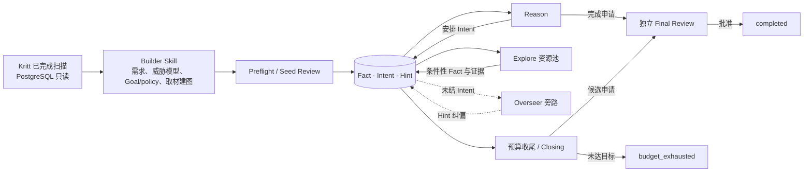

# Cairn Audit · Cairn 二次开发版

面向 **Kritt 辅助的白盒代码审计与多 Agent 组合研究**。复用 Cairn 的黑板架构，在共享的 Fact–Intent 图上安排探索、积累条件性结论，并由独立终审判断研究目标是否达成。

> 本仓库 Fork 自 [oritera/Cairn](https://github.com/oritera/Cairn)，属于独立二次开发版本。保留上游 Git 历史、原作者署名和 [GNU AGPLv3 许可证](LICENSE)，不代表上游官方发布。
>
> [上游 README（本地开发基线）](README.upstream.md) · [二开记录与提交索引](DEVELOPMENT.md) · [使用指南](docs/builder-prepare.md) · [服务与恢复](docs/managed-service.md)

## 为什么做这个 Fork

Kritt 的自动化扫描已经能积累入口、执行流程和候选发现。这个版本把这些材料交给交互式 Builder，再由 Cairn 在同一张图上继续研究：验证缺失条件、检查不同机制能否衔接、保留反证，减少从零重复阅读。

代码审计中的 Fact 是带条件和证据状态的观察，不因写入图就自动成为漏洞证明。项目输入、研究产出、导入材料与审核结论分别保留身份；`Complete` 是完成申请，`completed` 需要独立终审通过。

## 已完成的二开能力

| 能力 | 当前行为 |
| --- | --- |
| 原生 Builder Skill | 在 Claude Code 当前会话中交互开题、确认资源池、读取 Kritt 材料与源码、生成及修订 AuditPlan，提交后查询、暂停或恢复任务 |
| Kritt 只读接入 | 从 PostgreSQL 读取指定扫描，固定 scan/commit 和输入视图；研究阶段通过固定的 describe/search/get 入口按需读取，保存查询回执 |
| 审计契约与威胁模型 | 将目标效果、部署、攻击者能力、范围、CVSS 约束和有来源的威胁模型保存在 Goal/policy 中；未知项保留为未知 |
| 独立准备与验收 | 开题有 Preflight 和 Seed Review；Reason/Closing 提交候选后，由独立 Final Review 核验候选及必要前提 |
| Intent 旁路监督 | Overseer 异步观察未结 Intent，以 Hint 纠正方向与条件漂移；不逐条认证运行期 Fact，不阻塞研究和收尾 |
| 组合研究与规划记忆 | 保留条件、状态转换和逻辑依赖；Reason 可保存已考虑连接、暂搁原因、重开条件与下一步重点 |
| 按角色配置资源池 | 每个角色选择可用 harness 和数量；Explore 在同一图内混合并发，容量为各数量之和 |
| 时间预算与结案 | 预算结束后停止派发新探索，允许在途工作收敛，并执行有界 Closing/终审；未达目标记为 `budget_exhausted` |
| 暂停与断点恢复 | 暂停、停机不继续消耗运行预算；恢复原图、材料、阶段和剩余余额，已完成 Intent 不重复执行，旧世代不能写回 |
| 运行面板与复盘 | 展示预算、角色池占用、状态和调用回执；离线保留快照，支持历史回放与结果导出 |
| 图节点来源追溯 | 详情显示 Fact 实际产出 harness、Intent 提出/执行 harness、Hint 发出者；旧数据仅按固定配置精确映射，未知不猜测 |
| 上下文优化 | 固定契约集中交付，角色从短导航和必要节点出发按需读源码与材料；内部哈希、租约和来源运维信息不占据默认研究图 |

保留普通 generic 项目及原有接口；当前推荐的审计入口是 **原生 Builder Skill + 人工启动的受管理服务**。历史批处理入口仍用于兼容已有自动化。

## 工作流程



Kritt、Cairn 服务由用户手动启动。Builder 可以使用在线服务提交并开始研究，但不负责启动、关闭或重启服务。Kritt 后续扫描不会在已有研究恢复时替换其固定输入。

Overseer 是弱干预旁路；Final Review 是完成验收。完成申请等待终审时会短暂停派新研究，这与旁路监督等待无关。

## 支持的本机 harness

| 配置键 | 本机命令 | 模型配置 |
| --- | --- | --- |
| `claudecode` | `claude` | 沿用 Claude Code 的本机配置 |
| `grok` | `grok` | 沿用 Grok Build 的本机配置 |
| `pi` | `pi` | 沿用 Pi 的默认 provider/model/thinking |
| `codex` | `codex` | 沿用 Codex CLI 的本机配置 |
| `minimax` | `mcode` | 沿用 MiniMax Code 的本机配置，当前仅支持 local |

这些名字代表 harness，不代表固定 LLM。可以通过相应 CLI 或本机模型配置工具选择模型。Cairn 的 `role_pools` 只分配 harness 和数量，不另建模型/凭据管理层。

例如，同一项目最多并发五个 Explore：

```yaml
role_pools:
  explore: {claudecode: 1, grok: 1, pi: 1, codex: 1, minimax: 1}
  reason: {claudecode: 1}
  preflight: {claudecode: 1}
  seed_review: {claudecode: 1}
  overseer: {claudecode: 1}
  closing: {claudecode: 1}
  final_review: {claudecode: 1}
```

Reason、Preflight、Closing、Final Review 每项目仍串行；池决定选择哪个执行者。Overseer 名额用于同时观察不同 Intent，不是多票表决。默认示例保持各角色一个 Claude Code，按实际需要调整。

## 快速开始

### 1. 安装与检查本机环境

本地执行使用 Python 与 POSIX 进程管理；开发验证主要在 macOS 完成。准备 Python 3.13、[uv](https://docs.astral.sh/uv/)，以及所选 harness 的已安装、已配置 CLI。运行前在**启动 Cairn 的同一个终端**确认命令可用；桌面应用提供的 PATH 不一定存在于普通终端。

```bash
git clone https://github.com/Opr4Mp3r/Cairn.git
cd Cairn
uv sync --project cairn --group dev --python 3.13

# 已有配置不要覆盖；首次使用时复制示例。
cp dispatch.service.example.yaml dispatch.service.yaml

# 默认配置使用 Claude Code。
command -v claude
claude --help
```

若启用其他 harness，同样检查 `grok`、`pi`、`codex` 或 `mcode`。需要时将其真实安装目录加入当前终端 PATH；本仓库不会自动安装或登录这些 CLI。

### 2. 配置审计输入

使用 Kritt 材料时，先由用户完成 Kritt 扫描，再编辑 `dispatch.service.yaml`：

- `controller.kritt.targets`：仓库名、扫描 ID、commit、匹配的本地源码及外置 manifest。
- 可选 `references`：官方安全文档、部署说明、威胁模型等资料。
- `role_pools`、任务超时和时间预算：按本次研究需求设置。

配置文件中的相对路径以配置文件所在目录解析。示例目标是占位配置，需要替换为自己的输入。源码版本必须与扫描和 manifest 对应，切换扫描不会自动切换源码。

Kritt 数据库连接使用具有必要 SELECT 权限的账号；不要把密码写进仓库：

```bash
export CAIRN_KRITT_READONLY_DSN='host=127.0.0.1 port=5433 dbname=open_kritt user=YOUR_READONLY_USER'
```

也可以使用已有离线视图，格式与准备方式见 [Builder 指南](docs/builder-prepare.md) 和 [Kritt 取材指南](docs/kritt-probe.md)。本仓库不包含 Kritt 服务，也不负责触发其扫描。

### 3. 用户手动启动 Cairn 服务

```bash
uv run --project cairn cairn up \
  --config dispatch.service.yaml \
  --db-path ./datas/cairn-service/cairn.db
```

默认服务地址为 `http://127.0.0.1:8000`。端口在 YAML 的 `server` 中设置。确认就绪：

```bash
curl -s http://127.0.0.1:8000/runtime/health
```

服务应返回 `managed: true`、`ready: true`。数据库及同级服务目录需要保留；同一数据库只启动一个实例。

### 4. 在 Claude Code 中使用 Builder

在本仓库打开 Claude Code，使用项目内 Skill：

```text
/cairn-builder 使用我的目标配置，先确认资源池，再基于已完成的 Kritt 扫描建立研究任务；
静态检查指定入口的调用、终止和鉴权条件，引用源码；部署与匿名可达性未知时保留未知。
```

Builder 负责需求问答、只读取材、源码阅读、编写 `plan.json`、根据独立预审意见修订，并提交到已启动的 Cairn。也可以只准备方案而不提交。

需要脚本化时，`prepare` 生成输入和 schema，按该 schema 编写 `plan.json` 后再 `submit`：

```bash
uv run --project cairn cairn prepare \
  --config dispatch.service.yaml --target YOUR_TARGET \
  --goal '静态核对入口鉴权条件，保留未知并给出源码证据' \
  --run-dir /absolute/path/to/new-run

uv run --project cairn cairn submit \
  --server http://127.0.0.1:8000 \
  --run-dir /absolute/path/to/new-run \
  --config dispatch.service.yaml
```

`run-dir` 使用新的目录，放在目标源码之外。`submit --config` 明确提交本次执行快照；省略时使用 prepare 保存的快照。修改 YAML 不会热更新已有任务。

## 查看、恢复与追溯

```bash
uv run --project cairn cairn status --server http://127.0.0.1:8000 --run-dir /absolute/path/to/run
uv run --project cairn cairn pause  --server http://127.0.0.1:8000 --run-dir /absolute/path/to/run
uv run --project cairn cairn resume --server http://127.0.0.1:8000 --run-dir /absolute/path/to/run
```

服务崩溃后，使用相同配置和数据库手动启动，再显式恢复原项目。已完成的 Intent 保留；未完成的 Intent 使用新会话继续。运行时采用 2 秒心跳、10 秒延迟告警与 60 秒硬失联窗口。

| 位置 | 可查看的材料 |
| --- | --- |
| 网页图详情 | Fact 实际产出方、Intent 提出方/执行方、Hint 来源；未知来源明确标注 |
| `GET /projects/<id>/provenance` | 独立的 harness/Worker 来源 JSON，不加入研究图上下文 |
| 用户 run 目录 | 原始方案、需求问答、提交定位、修订意见与最终结果 |
| 服务 `submissions/` | 接纳时的方案、固定材料及执行快照 |
| 服务工作区 | 各代研究/审核调用回执、原始输出、规划记忆与 Kritt 查询回执 |
| 结果导出 | `result.json`、`graph.yaml`、`timeline.txt`、`audit.json`、`completions.json` |

历史数据只能还原已经记录的来源，不从 Worker 名字猜测。开题种子作为导入材料，Seed Review 的 harness 不会被当成其原作者。来源字段只记录 harness/Worker，具体模型与 usage 是否出现在原始回执中取决于 CLI。

## 验证与边界

当前代码快照的本地记录（2026-10-16）：Python **803 项通过、2 项跳过**，另有 6 个已有弃用警告；前端行为 **30 项通过**。来源功能还使用隔离浏览器核对了 Fact、Intent、Hint、历史回放与离线快照。

```bash
uv run --project cairn --group dev pytest cairn/tests -q
node --test cairn/tests/runtime-panel.test.cjs
```

Pi、Codex、MiniMax 已做真实 CLI 文件读取和会话续接验证。它们不是完整真实目标审计，也不能保证漏洞发现率或结论正确；MiniMax 的部分逐字复述出现末尾换行偏差，失败证据未被重标为通过。

当前边界：

- 已实现时间预算，尚无统一的累计 Token 预算控制。
- 没有统一的目标应用部署、动态 PoC 执行或正式漏洞报告生成器。
- Goal/policy、独立终审及旁路 Hint 不能保证模型永不夸大；条件和未知仍须保留。
- local harness 以当前用户权限无人值守执行，不提供强沙箱；后台 Worker 移除 Kritt DSN 环境变量，但原生 Builder 仍继承宿主环境。
- 启动终端缺少 CLI 时，当前调度可能把失败任务重新派发；先修复 PATH，不能以 App 内的调用结果代替正式终端检查。
- 来源功能会为旧库添加可空字段并保留数据；回退旧代码前应使用相应版本的数据库备份，旧版本不能直接写已升级的 Hint 表。

本仓库用于自有或已获授权的源码审查与研究。

## 文档与开发记录

- [二开提交记录](DEVELOPMENT.md)
- [Builder 使用与资源池](docs/builder-prepare.md)
- [人工服务、暂停恢复与运行面板](docs/managed-service.md)
- [Kritt 只读取材](docs/kritt-probe.md)
- [本地审计兼容入口](docs/audit-local.md)
- [组合研究设计](docs/specs/kritt-cairn-compositional-research.md)
- [上下文最小改造方案](docs/specs/audit-context-minimal-refactor.md)
- [审计节点表达示例](docs/specs/audit-context-examples.md)
- [任务恢复设计](docs/specs/task-recovery-mvp.md)

## 致谢与许可证

原始引擎来自 [oritera/Cairn](https://github.com/oritera/Cairn)。原作者和上游贡献者的代码、提交与许可证均保留；本 Fork 的新增记录继续追加在该历史上。

项目沿用 [GNU AGPLv3](LICENSE)。上游介绍及授权说明见 [基线原版 README](README.upstream.md)；上游原有容器/通用探索用法也可在那里查阅。
