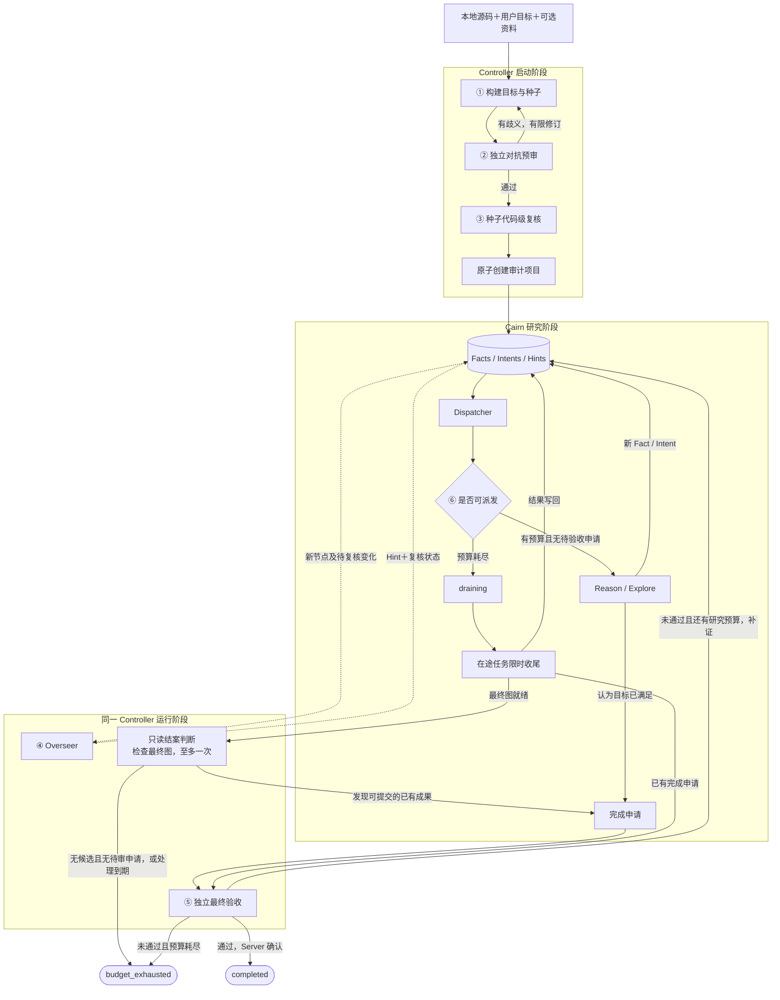

# Cairn 审计控制器 MVP 开发方案（已完成的 audit 路径）

本文定义代码审计控制器的模块位置、运行流程、协议增量、开发任务和验收标准。目标是从本地源码目录和用户需求出发，通过控制器创建并启动 Cairn 审计项目，完成研究、复核、验收或预算退出的闭环。

状态更新：2026年10月7日。本文所述CP1—CP6已完成，CP6交付提交为`a2c64d9`。下文保留原audit模式的设计和历史开发任务，用于理解、使用及维护既有功能，不是当前剩余开发清单。

新的Kritt集成以[kritt-builder-mvp.md](kritt-builder-mvp.md) v0.3为准，使用普通generic研究路径。本文的对抗预审、种子复核、Overseer、终审、预算恢复及历史验收矩阵不构成B-CP2之后的新增要求；已有audit功能及其运行语义保留。

原方案于2026年10月4日基于`oritera/Cairn`的`8e7e0ea`制定。以下“首版”“开发任务”等措辞均指当时的audit控制器开发。

## 1 已确认的 MVP 范围

| 项目 | 本版约定 |
| --- | --- |
| 模块归属 | 控制器属于 Cairn Python 包，建议位置为 `cairn/src/cairn/controller/` |
| 运行方式 | 一个 Server、一个 Dispatcher；每个审计项目一个 Controller 独立进程，使用同一 Cairn 安装和配置，不支持同项目多个控制器并行接管 |
| Agent 接入 | 复用 Cairn 的 WorkerDriver、注册表、WorkerConfig、执行后端和进程管理 |
| 首版 harness | 默认配置和真实验收只使用 `claudecode`；接入代码按 Cairn 注册与能力校验，不另设类型白名单 |
| 首版执行环境 | `runtime.execution: local`，复用本机已登录的 Claude Code |
| 输入 | 本地仓库目录、用户目标、可选本地安全文档、可选种子 JSON |
| 数据存储 | Cairn 现有 SQLite 数据库；审计增加的结构化记录也由 Server 保存 |
| 研究能力 | 沿用 Reason 和 Explore；首版审计初始化固定禁用 Bootstrap，其完成调用仍须接入同一验收规则并用专项夹具验证 |
| 控制能力 | 目标构建、对抗预审、种子复核、Overseer、独立最终验收、时间预算和有限收尾 |
| 验收目标 | 能从控制器启动任务并有限结束，不要求真实审计一定找到漏洞 |

本版不接入 open-kritt 或 PostgreSQL，不建立新的 Web 控制器界面，不实现生产级身份认证、权限隔离或部署加固，不实现硬 Token 上限。保留现有 harness 的实现与回归能力，控制器首版仅验证 `claudecode`。原有项目的通用探索模式继续可用。

任务超时、结果校验、证据状态和完成验收属于功能正确性，纳入 MVP。不得因暂不做生产防护而把这些规则替换为仅靠提示词约束。

## 2 模块位置与职责

控制器是 Cairn 的内部模块，但不是 Server 请求处理线程，也不是 Dispatcher 中新增的一类研究任务。它以独立 CLI 进程运行，通过 HTTP 接口读取图和提交审计判断。

| 模块 | 职责 | 不承担的职责 |
| --- | --- | --- |
| Controller | 构建项目、调用构建和复核 Agent、轮询新节点、提交 Hint 和复核结果、处理完成申请、输出结案结果 | 不直接写 SQLite，不维护第二套 harness 适配器 |
| Server | 保存图、审计规则、复核记录、完成申请和期限；执行结构与状态校验；事务性结案 | 不在 HTTP 请求内调用模型 |
| Dispatcher | 研究任务派发、claim、心跳、取消、现场管理、预算到期停止派发 | 不替代独立审计验收 |
| WorkerDriver 和 Runtime | Agent 命令、会话、响应抽取、环境及进程执行 | 不判断某条审计主张是否成立 |

建议新增文件按实际实现需要保持集中，不为每个角色建立类或独立服务：

```text
cairn/src/cairn/
  controller/
    __init__.py
    app.py                  # 新建、恢复、阶段编排、轮询、结案
    models.py               # 审计阶段的输入输出契约
    prompts/
      build.md
      preflight.md
      seed_review.md
      overseer.md
      closing.md
      final_review.md
  dispatcher/
    runtime/
      execution.py          # 从 tasks/common.py 提取的共享进程执行函数
    workers/                 # 继续使用现有 Driver 与注册表
  server/
    routers/
      audits.py              # 审计初始化、复核、完成申请和预算接口
```

Controller 配置作为现有 DispatchConfig 的可选部分加入。Server 请求模型和数据库迁移沿用现有位置；协议客户端仍扩展现有 CairnClient。优先复用现有文件，不整体搬迁 `dispatcher/workers/` 或建立新框架。

## 3 主流程与介入点

实线表示主流程，虚线表示运行期旁路监视。



| 介入点 | 输入 | 输出与动作 |
| --- | --- | --- |
| ① 构建 | 源码、用户需求、提供的文档或种子 | 部署基线、威胁模型来源、目标约束、逐条种子主张和初始探索方向 |
| ② 预审 | 构建结果、原始用户需求 | 通过，或指出字面满足但实际不符合意图的反例，交回 Builder 修订 |
| ③ 种子复核 | 每条种子、固定源码和相关控制路径 | 逐条证据、条件和复核状态；不能沿用输入自报的已验证标签 |
| ④ Overseer | 新 Fact、新 Intent、前提复核变化 | 检查方向漂移、证据和条件遗漏；提交复核结果及必要 Hint |
| ⑤ 验收 | 完成申请、规则、当前证据和逻辑前提 | 通过、驳回或待验证；仅通过才能创建完成边 |
| 收尾后结案 | 最后任务写回后的最终图和已有证据 | 无已批准结果时作一次只读判断；可生成申请，不能开新探索；再由独立会话验收 |
| ⑥ 预算 | Server 保存的期限和项目状态 | 派发、暂停派发或进入有限收尾 |

## 4 共用 Cairn 的 Agent 能力

### 4.1 共用接入层

Controller 和研究任务共用以下现有能力：

- `dispatcher/workers/registry.py` 的注册入口与 `get_driver()`。
- `WorkerConfig` 中的 worker 名称、harness 类型、环境变量。
- `WorkerDriver.prepare_session()`、`build_execute()`、`extract_session()`、`extract_response_text()`。
- `ExecutionBackend` 和首版 LocalBackend。
- LocalProcess 的输出收集、超时和进程取消。

将 `tasks/common.py` 中现有进程执行逻辑提取为 `runtime/execution.py` 的公共函数。参数包含后端、环境句柄、WorkerConfig、完整 argv、超时，以及可选的 heartbeat lease 和 cancellation；返回原始 ProcessResult。

共享函数不解释 Fact、Intent、审计主张或阶段 JSON。Controller 与研究任务分别使用自己的结果契约。命令 argv 原样交给后端，不重新拼接 shell，不假设所有 Driver 都直接返回纯文本。

Controller 的调用链为：解析角色引用 → 获取 Driver → 创建新 session → 渲染阶段 prompt → 构造命令 → 共享进程执行 → Driver 抽取会话与答案 → 审计 schema 校验。

### 4.2 角色与会话

| 角色引用 | 阶段 |
| --- | --- |
| builder | 目标和种子构建、收到预审问题后的修订、收尾后的只读结案判断 |
| reviewer | 对抗预审、种子复核、Overseer、最终验收 |

默认配置中两种角色都引用同一个 `claudecode` Worker，这不是 Controller 的类型限制。Controller 内部串行调用 Agent；每次阶段调用使用新 session，不恢复 Builder 或结案判断的会话来做独立复核。阶段 prompt 提供原始证据路径、固定规则和必要上下文，不把发现者的解释当成唯一依据。

研究任务的 execute/conclude 仍沿用现有同 session 收尾语义。Controller 阶段首版使用单阶段调用：超时或不合格输出不会升级为有效审计判断。

配置共享不意味着跨进程共享并发计数。MVP 中 Controller 至多同时运行一个 Agent 调用，Dispatcher 的 `max_workers` 与 `workers[].max_running` 只限制研究任务。示例配置最多同时有一个研究进程和一个控制器 Agent 进程；运行记录分别归属阶段与项目。

### 4.3 harness 扩展规则

后续新增 harness 时，只在 Cairn 的 Driver、注册与公共配置校验处扩展。Controller 通过 worker 引用选择它，阶段流程不增加专属分支。

Controller 不维护 claudecode 白名单。启动校验依赖共享配置与注册入口：Worker 已注册、对应 Driver 支持所选执行方式、所需 CLI 或运行材料可用。真正的能力差异在 Cairn 公共 Driver 或注册信息处表达，不复制到 Controller。首版只对 claudecode 承诺真实验收；其他 Driver 的审计结果契约仍需相应适配验证，不能仅因注册存在就宣称已验证可用。

新 Driver 必须在对应执行环境下满足命令、会话和响应抽取契约；需要的预置文件由 Driver 与后端负责。保留已有 Pi 的完整命令包装与事件抽取，不为了共享执行函数改写其行为。不要预先为未使用的 harness 添加制品工厂或插件系统。

首版沿用可用的文本答案通路。后续改为 CLI JSON 输出或采集 usage 时，在 Driver 层解包 CLI 结果，再把答案交给业务 schema，不能把 CLI 的结果封装误解析为模型审计答案。

## 5 输入与本地工作目录

新增控制器命令的拟定形式：

```bash
uv run --project cairn cairn audit \
  --repo /absolute/path/to/repository \
  --goal "寻找默认部署下的未授权 RCE" \
  --config dispatch.audit.yaml
```

可选输入为重复的 `--reference /absolute/path/to/document` 和 `--seeds /absolute/path/to/seeds.json`。提供种子只改变 Builder 的输入来源，不跳过预审或独立复核。首版从目标仓库及所提供的本地文档整理威胁模型；自动互联网检索与历史 CVE 拉取不作为运行必需能力。

CLI 校验目录和资料是否可读，记录仓库真实路径、Git commit 与工作树状态。无 Git 仓库时记录快照标识；有未提交内容时，证据记录相应文件内容摘要，不能只用 HEAD 代表当前代码。无法确认部署或鉴权条件时保持未知，不用推导假设冒充官方声明。

控制器准备阶段使用工作根下的 run 目录；项目创建后，研究与复核使用项目工作目录。项目目录放置 `repo` 引用、输入快照和 Agent 结果文件，首版可用指向本地源码的符号链接。Prompt 明确源码真实路径和资料路径，并要求审计任务读取代码、把实验产物保存在工作目录。

相对 workspace_root 统一按配置文件所在目录解析并转换为绝对路径，三个进程使用同一结果。初始化先保存不可派发的 stopped 项目与 `preparing` 阶段；Controller 根据真实项目 ID 准备源码引用和材料，确认就绪后通过审计激活接口进入 active。目录未就绪或准备失败时不得开放调度。

源码可见性必须端到端验证：Worker 读取指定仓库中的一个可识别文件并报告匹配内容。仅把路径字符串写入 origin 不算通过。源码证据包含内容摘要，源码发生变化时，旧证据不能直接支撑完成；MVP 停止该项目并记录 `baseline_changed`，由用户以新基线重新启动。

## 6 审计数据与事实语义

Server 是研究图与审计结构化状态的唯一写入入口。Agent 原始输出、实验材料和大文本保存在工作目录，数据库保存引用与摘要。Controller 不能绕过协议直接修改 SQLite。

| 记录 | 最小内容 |
| --- | --- |
| 审计项目元数据 | `mode=generic|audit`，默认 generic；audit 保存 repo 路径、基线、原始需求、固定 policy 与摘要、阶段、期限、audit_revision、reason_revision、终止原因 |
| policy | 预期漏洞效果、部署条件、攻击者能力、范围与信任边界、CVSS 指标条件、证据要求 |
| Fact 审计元数据 | 证据引用、必要条件、验证层次、`premise_ids`、复核状态及理由 |
| 复核记录 | 对象与版本、阶段、session、执行状态、成功执行后才有的判断、错误类别、已用次数、固定本轮 deadline、材料引用、可用 usage |
| 完成申请 | 支撑 Fact IDs、完成说明、申请者、policy 与基线摘要、申请快照和处理状态 |
| Controller 处理记录 | 已处理对象及其版本、执行阶段、结果引用、最终处理进度；closing 候选内容与申请提交凭据，用于去重和恢复 |

沿现有 schema 增量添加审计记录与列，初始化或迁移可重复执行。MVP 不引入 ORM、第二套图存储或通用事件溯源系统。

### 6.1 固定目标

policy 在项目启动后冻结；修改目标或部署基线时新建项目。Goal 是供模型阅读的表达，完成验收必须同时检查固定 policy 的各项条件。

例如，RCE 效果、匿名身份、默认部署、威胁模型内的有效入口和 CVSS 条件分别判断。`AV:N / PR:N / UI:N` 不单独证明默认部署或 RCE；非默认配置也不能机械地变成 `AC:H`。参考 [CVSS 3.1 指标定义](https://www.first.org/cvss/v3.1/specification-document) 与 [配置评分说明](https://www.first.org/cvss/v3.1/user-guide#2-3-3-assume-vulnerable-configurations)。

对抗预审使用明确反例，例如依赖多个可选配置、把操作者布置环境算作攻击者能力、用其他高影响漏洞替代 RCE。允许有限次数修订；达到上限仍有未解决歧义时，返回构建失败并保留原因，不启动研究。Goal 不包含全局不可能性出口。

### 6.2 Fact 状态

审计 Fact 使用 `unverified`、`verified`、`refuted`。`verified` 表示内容在记录的条件与基线下得到支持，不表示无条件成立。缺运行时、超时、未找到调用者或一次失败响应不能自动判为 `refuted`。

普通 Fact 尽量对应一条可独立支持或撤回的主张，避免把代码观察、匿名可达性和 RCE 影响揉成一个结论。引用验证先用代码检查文件、行号和内容摘要，再由独立复核追踪框架、路由、权限、部署与效果。完整静态证明可以作为证据，测试替身或原函数实验须标明跳过的控制层。

`origin` 保存输入范围和基线，`goal` 保存目标定义；它们不是漏洞成立的证据，不接受普通 Fact 的机制性验证。完成申请不能仅凭 origin 或 goal 获得批准。

种子逐条复核后写入图；缺证项仍可保留为 `unverified` 并创建验证 Intent。研究新产出的审计 Fact 默认 `unverified`，不能由研究 Worker 自报验证状态。

### 6.3 前提与因果来源

现有 Intent `from[]` 保留探索来源。另用 `premise_ids` 表达某条主张成立所必需的逻辑前提，不能把所有探索来源自动当成证明依赖。前提必须属于同一项目、真实存在，不允许自引用或循环。

未验证 Fact 可以触发验证任务或显式条件分支，但不能成为已批准完成证明的前提。某条前提变为 refuted 后，Server 或复核提交逻辑将依赖它的主张降为待复核，并使相关完成申请失效；保留没有依赖它的已确认内容。

Reason 输入同时包含可用于证明的 Facts 与待验证主张。探索允许引用待验证对象来安排验证；完成路径则检查整个 `premise_ids` 闭包均受支持，且所有必要条件符合 policy。仅在 prompt 中说明 UNVERIFIED 不构成这个规则的实现。

## 7 原子初始化与协议增量

审计初始化使用专用入口，普通 `POST /projects` 保持已有通用项目语义。初始化先校验完整请求，再在一个事务中写 stopped 项目、origin/goal、policy、种子及初始 Intent。Builder 的临时节点键在事务内映射成 Server 分配的真实 ID；来源缺失、重复或循环导致整体失败。初始化与激活分开，避免数据库提交成功而文件现场尚未就绪的竞态。

每条导入种子通过已结论的 `seed_import` Intent 从 origin 接入图，并在 Fact 元数据中保留原始资料来源和复核结果。导入边只表示知识进入图的来源，不表示其内容已证实；未验证种子仍保持 unverified。逻辑前提由 premise_ids 单独表达，不借导入边替代。

首版审计初始化固定 `bootstrap_enabled=false`；带种子的图不满足现有 Bootstrap 初始态条件，启用这类项目的 Bootstrap 留到后续。初始 Intent 包括高价值探索和必要的前提验证；初始化没有可派发方向时，Controller 补齐方向或让 Reason 生成，不能把零方向当成已完成。

下列路由为拟实现的最小协议，实际模型定义仍集中在 Server 与共享客户端中：

| 路由 | 用途 |
| --- | --- |
| `POST /audits` | 原子创建审计项目，返回完整项目和审计元数据 |
| `POST /projects/{id}/audit/start` | 确认现场就绪，幂等激活 preparing 项目并保存期限；不能用它重置已开始的预算 |
| `GET /projects/{id}/audit` | 读取规则、阶段、期限、完成申请及 Controller 处理记录 |
| `POST /projects/{id}/audit/reviews` | 以对象版本提交种子或运行期复核结果、必要 Hint 和处理凭据 |
| `POST /projects/{id}/complete` | 通用项目继续直接完成；审计项目只接受完成申请 |
| `GET /projects/{id}/audit/completions` | 读取待处理和历史完成申请 |
| `POST /projects/{id}/audit/completions/{request_id}/review` | 提交独立验收；通过时事务性生成完成边和 completed |
| `POST /projects/{id}/audit/budget` | 幂等进入 draining 或在满足结案条件后标记 budget_exhausted |

preparing 审计项目只能通过审计激活接口开放调度；普通 status 接口不能把它直接恢复为 active。UI 对该阶段显示准备状态，并禁用普通恢复操作。

现有详情和 YAML 导出对审计项目增加审计元数据、Fact 证据状态和必要节点 ID，使 Controller 和 Worker 读取同一份事实。heartbeat 等协调字段仍不作为知识证据。

审计 `/complete` 返回 `202` 和完成申请记录，通用项目返回原有完成结果。Dispatcher 与 Controller 必须识别这两种语义：任务 outcome 为 success 只表示请求处理成功，不表示项目 completed。人工 UI 的完成操作也遵守此规则。

## 8 Overseer 与最终验收

### 8.1 运行期复核

Controller 轮询现有项目详情和审计记录，不增加消息队列或实时事件系统。对象处理键使用对象 ID 加复核输入摘要，摘要覆盖证据、条件、逻辑前提及前提的复核状态，排除对象自己的复核输出。不能使用项目总 revision 作为对象处理版本，否则一次复核会触发对自己的下一次复核。

复核记录和对应 Hint 使用同一处理键，在 Server 事务内去重。Controller 重启后读取已保存的处理记录，不重复注入相同纠偏；重复提交相同结果、完成申请状态、处理游标和 heartbeat 不推进以下项目版本。

项目版本明确分成两种，不再以一个总版本同时承担审核和调度：

| 版本 | 增长条件 | 用途 |
| --- | --- | --- |
| audit_revision | 新增 Fact、Intent、Hint，或证据、条件、逻辑前提、有效复核状态实际变化 | 标识验收时读到的图与知识快照 |
| reason_revision | 新 Fact、有效 Hint，或会改变可用前提、条件与研究方向的复核变化 | 触发审计项目重新 Reason |

单纯新增 Intent，包括 Reason 自己提出的方向，仅增加 audit_revision，不增加 reason_revision。Intent 的正常审阅完成、处理游标、heartbeat 和重复提交也不触发 Reason。保留现有“首次需要判断”及 open intents 从有到无的触发条件；不按 audit_revision 的每次增长优先派 Reason。

Reason 保存派发时实际消费的 reason_revision，并在成功后用该值更新 checkpoint；执行期间新增的独立变化不会被结束时的最新版本覆盖。复核输出没有改变事实条件或方向时，不制造新的触发版本。现有计数 checkpoint 原本不会因单独新增 Intent 重触发，此处是对新审计语义的约束。

Overseer 先执行低成本引用和结构检查，再调用 reviewer 检查方向、最弱前提及隐藏条件。Agent 必须逐项输出接受、待验证或反证理由。有效发现保留其条件；有问题的主张更新复核状态，必要时通过 Hint 建议验证或调整探索方向。

Hint 不撤销完成、不单独改变事实可信度，也不自动派发任务。需要补证时，Controller 可通过已有 Intent 接口创建明确的验证方向。有效复核变化按上表推进 reason_revision；Dispatcher 据此补充现有 Fact/Hint 数量检查，不因 Controller 新建验证 Intent 再次进行无条件推理。

### 8.2 完成申请与验收

Reason、Bootstrap、Controller 的只读结案判断以及人工 Complete 对审计项目统一走申请入口，不能先创建 goal 完成边。申请去重依据 policy、基线、支撑 Facts 及其前提闭包的证据与条件摘要；相同证明依据复用申请记录。实质性 rejected 的同一依据不自动重审，不能靠新增无关 Hint 或改写结论措辞无限重提。

存在待验收申请时，Dispatcher 暂停该项目的新派发，Server 同时拒绝新 claim 和新研究 Intent，已有 lease 可续约和写回。Controller 优先处理在途产出的待复核证据，再读取最新快照做最终验收。审计项目仍保持 active 或 draining，不借用 stopped 来暂停派发。

复核执行与证据判断分开保存。执行记录使用 `attempt_status=success|error`；仅在 Agent 成功返回且 schema 合格时填写 `decision=approved|rejected|needs_evidence`。超时、CLI 故障和无效输出只产生 error，不形成新的证据判断，也不改变 Fact 的复核状态。

完成申请状态包括 `pending`、`approved`、`rejected`、`needs_evidence`、`stale`、`review_error`。其中 rejected 表示证据被反证或明确不符合目标，needs_evidence 表示尚缺证据或条件未确认，review_error 表示审核未成功执行。后两者不得伪装成证据不成立。

| 申请变化 | 派发与处理规则 |
| --- | --- |
| pending | 暂停新派发，等待已有任务收尾并进行验收 |
| pending 变 stale | 继续暂停；Controller 在期限内读取新快照，重新审阅时恢复 pending |
| pending 变 rejected | 保存实质性否定理由，解除暂停；相同依据不自动重审，有预算时可研究其他方向 |
| pending 变 needs_evidence | 保存缺口，解除暂停；有预算时可补证，相关证据改变后才自动重审 |
| pending 变 review_error | 有剩余自动尝试次数和时间时继续短暂暂停并重试同一申请；用尽后解除暂停、保留错误与人工重试入口 |
| pending 变 approved | 同一事务进入 completed，取消其余运行 |

复核自动尝试总数包含第一次调用，默认至多两次。第一次审核超时或 CLI 失败后，只要本轮 deadline 与 final_deadline 尚有余量，允许按相同证明依据再次审核；去重返回既有申请，不能把 error 当成 rejected 阻止重试。次数与本轮固定 deadline 持久化，轮询或进程重启不会重置。

自动尝试用尽的 review_error 不在每轮轮询中重新排队。用户可用恢复命令显式重试该申请，发起新的有限审核轮次，但不能修改证据判断、放宽 policy 或延长项目绝对期限。needs_evidence 默认等待相关补证后重审；rejected 只在相关证明依据变化后自动重审。预算耗尽时，审核 error 或证据不足按原类型保留并结案，不能统一转成 rejected。

批准提交携带本次实际审阅的 audit_revision、policy 摘要、基线和证据摘要。Server 在写事务内重新核对状态、证据及前提闭包，再一次性保存批准、生成完成边并切到 completed。heartbeat、lease release 和处理游标变化不增加 audit_revision。

复核期间有相关知识变化时，批准返回 stale。Controller 读取新快照后可重新复核已有申请；预算收尾阶段也允许这种复核，但不能因此开启新的探索。复核次数和时间受阶段限额约束。未验证或被反证的必要前提、与 policy 不符的条件、源码变化都阻止批准。

有研究预算的驳回结果通过 Hint 和必要验证 Intent 回到研究阶段；没有研究预算时保存部分成果与缺口，等待预算结案。不同 session 提供流程独立性，不以第二个 Agent 同意代替原始证据。

### 8.3 按项目选择研究 Prompt 和结果契约

研究任务在取得项目 mode 后，一次性选择 prompt 组和结果契约：generic 使用原来的 runtime.prompt_group 和 Bootstrap/Reason/Explore schema；audit 使用 Controller 配置的 research_prompt_group、固定 policy 和审计元数据 schema。不能只切 prompt 而继续用不匹配的结果解析，也不能把运行期全局 prompt_group 改成 audit 后影响同一 Dispatcher 的普通项目。

统一选择逻辑供三个研究任务及 execute/conclude 阶段调用；Controller 的 build、review 等阶段 prompt 仍位于 controller/prompts，与研究 prompt 组分开。配置加载时分别验证原有组和已配置的审计研究组资源；未启用 Controller 的旧配置按原规则读取。

## 9 时间预算与项目状态

时间口径须在日志和输出中明确：准备阶段受 build、preflight、seed_review 的超时与有限修订次数约束；研究期限从项目现场就绪并成功激活时开始。研究期内的 Overseer 时间包含在同一墙钟期限内。收尾和最终验收另有明确的时间窗口。整体耗时不宣称等于 research_seconds。

激活时一次性保存绝对 UTC 期限：research_deadline 为激活时间加 research_seconds，drain_deadline 为 research_deadline 加 drain_seconds，final_deadline 为 drain_deadline 加 final_review_seconds。晚发现超时或恢复进程不能从当前时间重新开启窗口；没有在途任务时可以提前收尾，但不能延后这些上限。本地进程超时使用单调时钟。

各阶段调用和可取得的 usage 都归属项目记录；准备阶段的记录在项目创建时一并关联。usage 缺失保存为未知，不能记成零，也不用耗时代替 token 数。

| 状态 | 新研究任务 | 已有任务 | 结案方式 |
| --- | --- | --- | --- |
| active | 有预算且无待验收申请时允许 | 续约、结果写回 | 提交申请后独立验收 |
| draining | 不允许，包括 bootstrap、普通 reason、新 explore 和重新认领 | 仅允许进入该状态时已有 lease 的任务续约、结果写回、有限 conclude fallback；收尾后可只读结案并提交申请 | 完成验收通过或预算结案 |
| completed | 不允许 | 取消剩余执行并清理 | 独立验收已通过 |
| budget_exhausted | 不允许 | 取消剩余执行并清理，保存已有成果 | 没有验收通过的结果或审核未完成 |
| stopped | 不允许 | 立即取消，保持既有硬停止行为 | 记录人工停止或运行错误原因 |

Dispatcher 每次派发前检查期限，超时幂等进入 draining。进入 draining 不能清空现有 claim，也不能触发当前“所有非 active 项目都取消”的逻辑；服务端写入守卫须区分新认领与已有 lease 的续约、写回。

审计 claim 带唯一 lease_id，后续续约与写回携带该凭据。进入 draining 时保存允许收尾的已有 lease；过期后不能以相同 worker 名称重新接手。Server 在认领与写入事务内检查期限，跨过 research_deadline 的新 claim 被拒绝，跨过 drain_deadline 的研究 Fact 写回被拒绝。已有 Reason 在 draining 返回的新增 Intent 不落图；完成申请仍可受理。

drain_seconds 到期后取消仍未结束的研究任务，停止新增研究事实；没有有效研究 lease 时可提前关闭研究写回并进入最终处理，不能在宣称最终图就绪后再接受迟到的研究 Fact。Controller 在同一个 final_review_seconds 窗口内按顺序处理最后的证据复核、只读结案判断、候选申请提交和独立验收，并保存各阶段进度；不得通过注入新 Intent 延长研究预算。执行失败与仍缺证据的结果如实保存，不冒充已验证。

无已批准结果时，Controller 对收尾后最终图执行至多一次成功的 closing 阶段。该阶段使用 builder 引用和新 session，只读现有 Fact 与证据，返回 candidate 或 no_candidate；不复用会创建 Intent 的普通 Reason，不执行新实验，不输出新 Fact/Intent。允许有限的执行错误重试，使用同一快照、本轮固定 deadline 和已保存尝试次数，恢复时不重复已经成功执行的 closing。

closing 的 candidate 可由 Controller 提交完成申请，不要求它持有研究 lease；Server 仅在最终处理阶段且 final_deadline 前接受这类控制操作。随后由 reviewer 的另一个新 session 独立验收，不能由生成候选的 session 自行批准。candidate 与既有申请相同时复用去重记录。最后一个 Explore 即使仅写 Fact、没有生成申请，也有机会通过此路径 completed。

closing 成功时先持久化完整结果、输入摘要和稳定候选键，再提交申请并保存关联 request_id。若 Controller 在两步之间退出，恢复时重放幂等的申请提交，直到已有申请得到关联；不重新调用成功的 closing，也不重置期限。提交结果未知时按候选键查询或重试，不能把候选存在误当成申请已落库。

closing 的 no_candidate 只表示当前已有成果没有可提交的候选，不证明不存在漏洞；已有未决申请仍须按剩余预算处理。closing 超时或失败保存为执行错误，不伪装成 no_candidate。证据复核、closing、终审、自动重试及格式修复共用既定 final_deadline，不因增加 closing 而延长预算。

有效批准与预算结案都通过同一 Server 权威事务仲裁，并重新校验期限和当前状态。结案前已有验收通过的成果则 completed；否则在最终处理结束或到期后 budget_exhausted。不能先标预算耗尽，再异步用旧批准覆盖它。最终处理到期时的未知项保留为待验证。

Controller 恢复时根据 Server 的 lease、申请和处理记录判断未决工作，不能用自己的空 futures 判断无人运行。即使 Dispatcher 已退出，Controller 也须根据已保存期限和 lease 到期推进收尾与结案。

Server 允许提前预算结案的条件同时包括：研究写回已关闭、最后证据处理已有记录、closing 已成功完成、其候选已幂等提交并处理完毕、没有有效研究 lease 或待处理申请。只看到 lease 和申请为空不足以结案。closing 尚未运行、候选尚未提交，或执行错误仍待允许的重试时，保留最终处理阶段；final_deadline 到期后才可带相应缺口或错误结案，不要求假造成功的 closing。期间有效批准仍按同一事务规则优先进入 completed。

## 10 配置与启动方式

新增配置节选的完整示例如下；当前 DispatchConfig 尚不接受 controller 部分。字段在实现时加入现有配置模型和校验，不维护第二份 Worker 定义。

```yaml
server: "http://127.0.0.1:8000"

runtime:
  execution: local
  worker_healthcheck: disabled
  max_workers: 1
  max_running_projects: 1
  max_project_workers: 1
  interval: 3
  healthcheck_timeout: 15
  prompt_group: default

tasks:
  bootstrap:
    timeout: 120
    conclude_timeout: 30
  reason:
    timeout: 60
    max_intents: 2
  explore:
    timeout: 180
    conclude_timeout: 30

local:
  workspace_root: "./datas/audit-workspaces"
  completed_action: keep

workers:
  - name: claude-main
    type: claudecode
    task_types: [bootstrap, reason, explore]
    max_running: 1
    priority: 0

controller:
  research_prompt_group: audit
  roles:
    builder: claude-main
    reviewer: claude-main
  poll_interval: 3
  max_goal_revisions: 2
  timeouts:
    build: 180
    preflight: 120
    seed_review: 120
    overseer: 90
    closing: 60
    final_review: 60
  review:
    max_attempts: 2
  budget:
    research_seconds: 1800
    drain_seconds: 120
    final_review_seconds: 360
```

seed_review 超时作用于整个种子复核批次，Agent 对每条种子分别输出判断。每次调用固定 deadline；调用超时取配置值与当前窗口剩余时间扣除进程终止宽限后的较小值。剩余时间不足以容纳终止宽限时不启动调用。每次调用允许至多一次输出格式修复，修复只重新整理已输出内容，不重复原审计动作；修复共享该次调用 deadline，不能重新获得完整时限。日志区分开始取消与进程实际结束时间。

对 final_review 和 closing 的执行错误，max_attempts 包括第一次调用。本轮执行 deadline 在第一次调用前固定为“最多 max_attempts 次单次时限”的总上限，并受 final_deadline 截断；每次尝试再按单次 timeout 和剩余时间剪裁。因此首次超时后仍可能有时间做第二次尝试，但重试和进程重启不会滑动延长本轮 deadline。显式人工重试可建立新的有限审核轮次，仍受原项目 final_deadline 约束；这不允许重复一次已成功的 closing。

启动前校验角色引用存在、类型在 Cairn 公共注册入口中、Driver 支持所选执行方式、CLI 可调用、两类研究 prompt 组及控制器阶段资源完整、工作目录与资料可读。MVP 使用 local 执行方式，示例和真实验收只配置 claudecode；运行代码不按 harness 名称设置 Controller 白名单。local 模式复用本机登录和配置，不把模型 API 健康检查作为必需条件。不存在的 CLI、无法调用的账号或不合格结果均给出明确错误。

保留 Server 和 Dispatcher 的独立启动方式；新增 `scripts/run-audit-local.sh` 作为本地演示入口，负责启动本次使用的三个进程、等待 Server 就绪，并在退出时结束自己创建的进程。脚本使用项目本地数据库路径和工作目录，不接管已有进程，也不依赖 Docker。直接使用 `cairn audit` 时连接配置指定的 Server，并要求对应 Dispatcher 已运行。

Controller 和 Dispatcher 收到退出信号后先取消自己持有的 Agent，有限等待进程组结束，再退出。LocalProcess 的 Agent 位于独立进程组，不能只结束父进程；启动脚本失败或退出时也须验证没有遗留 CLI 子进程，且不影响已有进程。

新增恢复入口采用同一命令的 `--project proj_001 --config dispatch.audit.yaml`，与新建任务的 repo/goal 参数互斥。恢复时读取规则、期限、处理记录和未决申请，继续监视与验收；不重新生成 policy、复制种子或重置预算。首版允许人工恢复 Controller，不实现无人值守多实例接管或 Dispatcher session 的持久化恢复。

恢复命令可额外指定 `--retry-review REQUEST_ID`，仅用于显式重试审核执行错误；普通恢复不自动清空已用尝试次数。实质性驳回仍需要相关证明依据变化，恢复操作不能把 rejected 改成 approved。

## 11 提示词与结果约定

控制器使用仓库内的短阶段 prompt，并显式附带必要的审计规范和资料路径。借鉴 whitebox-security-audit 的逐主张证据、身份能力差、必要条件、反证和验证层次，不直接执行其完整六阶段产物流程，也不把用户机器上的 skill 路径变成必需运行依赖。

| 阶段 | 最小结果内容 |
| --- | --- |
| build | policy、威胁模型来源及未知项、种子主张与条件、初始 Intent |
| preflight | 通过与否、不可接受的字面满足案例、矛盾与修订建议 |
| seed_review | 每条种子的状态、正反证据、路径与鉴权依据、必要条件、缺口 |
| overseer | 节点检查、复核状态变更、条件遗漏、方向建议及需要的 Hint |
| closing | 只读最终图，输出 candidate 的现有 Fact 引用与说明，或 no_candidate 及缺口；不输出探索任务或新事实 |
| final_review | 是否满足各项 policy、完整证明依据、前提检查、CVSS 每项依据、拒绝或待验证理由 |

结果使用 Pydantic 等现有能力校验类型、必需字段和引用。接受 JSON 不代表主张已经成立；逻辑状态仍由独立证据复核决定。资料缺失、格式失败与 Agent 进程失败分别记录，不把错误吞成空的成功结果。模型工具产生的副作用已发生时，不自动无限重跑同一阶段。

## 12 开发任务与依赖

任务编号用于执行与验收，不代表要求逐任务独立建包。每次实施应是可验证的小步修改。

| 任务 | 工作内容与主要位置 | 依赖 | 验收 |
| --- | --- | --- | --- |
| D0 运行基线 | 建立与 uv.lock 一致的兼容环境，运行既有测试，记录现状 | 无 | 基线测试可执行；任何既有失败与本次变更分开 |
| D1 共享执行 | runtime/execution.py、tasks/common.py 及三个任务调用；沿用 Driver/Backend | D0 | 研究与控制器共用执行函数；旧超时、取消、会话与 Driver 测试保持通过 |
| D2 审计数据协议 | models.py、db.py、services.py、routers/audits.py、app.py、CairnClient | D0 | 增量迁移可重复；初始化原子；通用项目行为不变；详情与导出一致 |
| D3 控制器调用与配置 | controller 核心模块、DispatchConfig.controller、公共 Driver 能力校验、角色引用、阶段 schema 和 prompt、最小源码夹具 | D1 | 真实 claudecode 通过 Controller 读取指定文件，返回与内容匹配的合格 JSON；独立 session、超时和错误可处理，不依赖完整审计协议 |
| D4 本地构建与种子 | CLI 输入、基线、资料传递、工作目录、预审修订、逐种子复核、初始化与激活 | D2 D3 | 真实 claudecode 从本地 repo/goal 构建并启动种子图；现场就绪前不可派发；未知项不冒充已验证 |
| D5 审计研究语义 | 按 mode 选择研究 prompt 与契约、任务审计元数据、Reason 可用前提、reason_revision 检查点 | D2 D3 D4 | 真实 Dispatcher 至少执行一次 Explore 并写回可核对 Fact；Intent 不自触发 Reason；同进程 generic/audit prompt 与结果解析正确 |
| D6 Overseer | Controller 轮询、低成本检查、独立复核、处理记录去重、Hint 与依赖撤回 | D5 | 重复轮询不重复纠偏；前提反证正确影响依赖主张 |
| D7 完成申请与验收 | 所有 Complete 调用、Server 申请/审核事务、执行错误与判断分离、Dispatcher 待审暂停、Controller 终审 | D5 D6 | Bootstrap/Reason/人工无旁路；错误可有限重试；同依据实质驳回不无限重提；旧快照不能批准 |
| D8 预算与恢复 | draining/budget_exhausted、写入守卫、取消/cleanup、固定期限、只读 closing、Controller 恢复 | D6 D7 | 最后一轮 Fact 无原申请时仍可独立验收；不新增研究；错误与缺证据如实保存；恢复不重置期限 |
| D9 启动与演示 | 本地启动脚本、最小审计夹具、终端输出、UI 状态与 Fact 标识、配置示例 | D4 至 D8 | 固定输出和假 Claude CLI 的端到端测试、真实 claudecode 演示均可执行 |

建议按以下可运行里程碑推进，D1 至 D3 的真实接入不等待全部数据协议、恢复或 UI 开发：

| 里程碑 | 阶段 | 必须已有的运行结果 |
| --- | --- | --- |
| M1 控制器接入真实 Agent | D0 D1 D3；对应 CP1 | 真实 Claude Code 读指定文件，Controller 获得合格且内容正确的结构化结果 |
| M2 控制器启动真实研究 | D2 D4 D5 | 真实 Controller 建图，真实 Dispatcher 完成一次 Explore 和 Fact 写回 |
| M3 独立复核与验收 | D6 D7 | 纠偏、待审暂停、成功验收与拒绝，以及审核执行错误的重试均可观察 |
| M4 有限结束与完整演示 | D8 D9 | 最后成果结案、预算退出、恢复和退出清理，完整流程使用真实 claudecode 验证 |

恢复、复杂的依赖撤回处理和 UI 标识按 D6 至 D9 补齐，不阻挡 M1、M2。基础的前提状态与完整证明检查仍属于对应协议和验收任务。最终 MVP 交付须包含四个里程碑，D9 不承担首次验证真实 CLI 或源码可见性的职责。

开发执行顺序按下节检查点串行推进：D0 → D1 → D3 → CP1；随后 D2 → CP2；再 D4 → D5 → CP3。D3 的真实接入不依赖 D2；虽然后者的工程依赖仅为 D0，本次协作约定在 CP1 通过后才实施 D2，避免协议工作抢先阻挡真实接入验证。M1 至 M4 是能力里程碑，CP1 至 CP6 是必须停止并等待验收的交接点。

## 13 开发检查点与验收放行

本节是已完成的CP1—CP6历史交付约定；新的B-CP阶段交付内容见[kritt-builder-mvp.md](kritt-builder-mvp.md)，不继承本节的专项证明材料和测试矩阵。

### 13.1 停止规则

本节约定来自用户确认的协作方式：同事负责开发和提交，Codex 负责代码审查、复现与验收。开发者完成一个检查点范围后立即停止新功能开发，不提前实现下一检查点的任务，也不以自己的测试通过或自评替代放行。

开发者提交固定代码快照和验收材料后，由用户交给 Codex 验收。Codex 针对该快照明确写出“CPx 通过，允许进入下一检查点”才算放行；“未通过”或“待验收”均不能继续。没有回复不等于通过。不使用有条件通过来跳过必需验证。

未通过时只修复当前检查点及其依赖中的问题，重新提交后复验。提交后若又改变待验收代码，应更新快照和材料；旧报告不能自动适用于新快照。进入下一阶段后继续运行已通过阶段的相关回归；若修改其已验收接口或语义，须说明影响并重新核对相应检查点，不能隐瞒为普通新增功能。

制定方案时各检查点均为待开发；截至本次状态更新，CP1—CP6已经完成。下表保留原分段内容，不代表仍需重做。

### 13.2 检查点总表

| 检查点 | 开发范围 | 到此必须停止 | 核心验收结果 | 通过后允许 |
| --- | --- | --- | --- | --- |
| CP1 共享执行与真实 Agent | D0 D1 D3 | 真实 Claude 读文件并返回合格结果后 | 运行基线、共享执行接缝、独立 session、真实源码可见性均有证据 | 实施 D2 |
| CP2 审计数据协议 | D2 | 数据、迁移及本阶段接口可复现后 | 原子初始化、激活就绪约束、元数据持久化和通用项目兼容 | 实施 D4 D5 |
| CP3 控制器启动真实探索 | D4 D5 | 真实建图和一次 Explore 写回后 | Controller → Server → Dispatcher → Claude → Fact 的链路运行成功 | 实施 D6 D7 |
| CP4 纠偏与独立验收 | D6 D7 | 运行期复核及完成申请通过和拒绝路径可复现后 | 前提、条件、去重、独立终审、执行错误重试和暂停语义成立 | 实施 D8 |
| CP5 预算收尾与恢复 | D8 | 最后成果结案、预算退出和恢复用例可复现后 | 有界收尾、只读 closing、恢复幂等及唯一结案状态成立 | 实施 D9 |
| CP6 完整 MVP 交付 | D9 | 完整真实演示和交付材料齐备后 | 启动、完整闭环、退出清理、用户可复现性和最终回归成立 | 标记 MVP 验收通过 |

### 13.3 CP1 共享执行与真实 Agent

提交 D0、D1、D3 的变更和验证结果；本点不要求审计数据库或完整控制器业务已经实现。使用仅验证 Controller 调用的配置或入口，不启动审计研究，也不要求 D5 的 audit 研究 Prompt 组提前完成；阶段提示词、Driver 和实际执行路径必须是真实实现。

- 在兼容依赖环境执行既有回归，给出基线命令、结果及与本次变更的区别。新引入失败必须修复；既有失败或验证缺项交由验收明确处理，不能静默略过。
- 用真实 claudecode 经 Controller 调用路径读取指定夹具文件，返回 schema 合格的结构化结果；文件内容不得预先作为完整答案塞进 prompt。保留调用输入、目标内容摘要、输出和 session，Codex 可替换文件中的标记值后复现。
- 核对研究任务和 Controller 共用 Driver、注册与进程执行函数，没有第二套 harness 名单或 subprocess 实现。验证新 session、超时、取消、无效输出及未知或不支持执行方式的 Driver。

固定输出测试可以验证失败分支，但不能替代真实读文件。只有入口定义、CLI --help 或 JSON 解析测试不算 CP1 通过。

### 13.4 CP2 审计数据协议

提交 D2 变更，用临时数据库复现本阶段接口和增量迁移。

- 增量迁移连续执行两次；既有通用项目能够正常读取、导出和按原契约操作。
- 合法种子整体写入；非法来源、重复引用或循环使请求整体回滚，无可调度半成品。核对 seed_import、真实 ID 映射、policy、证据状态与两种 revision 的保存。
- preparing 项目保持不可派发；现场就绪后激活且不重置已有期限，普通 status 操作不能绕过就绪约束。用实际接口返回及数据库状态核对，而非只检查 HTTP 成功码。

本点验收 D2 已实现的数据与接口行为；独立批准、Overseer 和预算结案的完整业务逻辑分别在 CP4、CP5 验收。尚未实现的路径必须明确列出，不能用假成功响应代替。

### 13.5 CP3 控制器启动真实探索

提交 D4、D5 变更，使用前两点已经通过的共享执行与数据协议。

- 从 repo、goal 和提供的资料通过真实 Controller 构建、预审、复核并激活审计项目；保留项目 ID、基线、种子及原始 Agent 结果。
- 真实 Dispatcher 至少派发一次 Explore，由真实 claudecode 读取指定仓库并写回可核对的 Fact。保留 Intent、claim、执行会话、Fact 证据和导出结果；不要求找到漏洞。
- 确定性验证 generic 与 audit 的 prompt 和结果 schema 选择；Reason 仅新增 Intent 不自触发，新 Fact 或有效复核变化能够触发，推理期间新增的变化不会被 checkpoint 吞掉。

仅创建项目或向数据库人工插入 Fact 不算通过。CP3 不等待恢复、复杂依赖撤回或 UI 完善；临时缺少的完整验收与预算能力需列明，并保证演示进程有限退出。

### 13.6 CP4 纠偏与独立验收

提交 D6、D7 变更；真实阶段调用可用小型夹具冒烟，判断分支用固定输出与实际 Server 接口确定性复现。

- 假种子前提和隐藏条件能被复核发现；相关逻辑前提被否定后不再支撑批准，其他独立成立的内容保留。重复轮询不会制造重复 Hint 或复核循环。
- Reason、Bootstrap 专项夹具及人工 Complete 均转为申请，不能直接完成审计项目。验收通过才创建 goal 完成边；待审暂停、驳回及缺证据解除暂停的规则可观察。
- 首次 CLI 错误或超时、后续同依据审核成功能够 approved；error 不改成 rejected，needs_evidence 不等同反证。核对尝试数、去重和固定 deadline，审核期间相关证据变化使旧批准失效，heartbeat 不使批准失效。
- 证明构建与独立验收使用不同 session，并能追溯到各自读取的输入、证据和判断。模型声称通过本身不算系统通过。

单靠提示词禁止夸大、只展示成功路径、或把执行错误当成实质性驳回，均不能放行。

### 13.7 CP5 预算收尾与恢复

提交 D8 变更；用可控时钟或短时夹具复现时序，避免依靠长时间等待或偶然运行顺序。

- 到期进入 draining，不派新任务或重新认领；已有有效 lease 可在窗口内写回，到截止时晚到 Fact 被拒绝，取消与结案均有界。
- 最后 Explore 只写 Fact、没有原完成申请时，closing 可生成候选，再经另一个 session 独立验收。closing 不开新探索、不重复成功执行、不重置 deadline；错误不冒充 no_candidate。
- 没有 lease 和申请但最后证据或 closing 未处理时不能提前结案。有效批准与预算退出并发提交时状态唯一，预算结束不宣称证明无漏洞。
- 在 closing 成功、申请尚未提交时退出并恢复，幂等补交申请且不再次运行成功的 closing；Controller 重启不重置期限，Dispatcher 不运行时也可按 lease 与期限有限结束。

验证须覆盖成功完成和预算耗尽两条结案路径，以及审核错误、迟到写回和恢复断点。仅修改状态字符串或演示一次 timeout 不算通过。

### 13.8 CP6 完整 MVP 交付

提交 D9 变更及整体验收材料，复用前五点的已验收结果并执行相关最终回归。

- 按交付命令在本地启动三个进程，使用真实 claudecode 从输入到 completed 或 budget_exhausted 完整运行，输出实际成果与限制。真实模型没有找到漏洞不影响功能验收；成功与预算路径均须有确定性测试。
- 配置示例只启用 claudecode，用户能看到阶段、项目状态、证据状态及最终结果；界面标识与 Server 实际状态一致。
- 正常退出、失败和中断后无遗留的测试 CLI 进程组；启动脚本只清理自己创建的进程，不影响已有进程。配置、启动说明、运行材料和必要测试足以在验收环境复现。

本点通过后才能标记完整 MVP 已验收；CP1 或 CP3 通过仅表示相应可运行能力已经成立。

### 13.9 每个检查点的提交与验收记录

开发者在 Cairn 仓库根的 `.claude/acceptance/CPx/` 提交一份 submission.md 和必要证据引用；不要求额外报告系统。材料至少包含：

| 材料 | 要求 |
| --- | --- |
| 检查点与范围 | CP 编号、完成的 D 任务、改动文件、未实现项和已知问题 |
| 代码快照 | HEAD 或提交号、工作区状态；有未提交修改时附 diff，新增文件附清单及内容摘要，确保可确定实际验收版本 |
| 环境与配置 | Python、依赖、Claude CLI 版本、使用的配置和源码夹具基线；配置提供去除密钥的版本 |
| 验证结果 | 可重跑命令、退出码、实际结果、关键断言、失败或未执行的检查；区分假 CLI 与真实 Agent |
| 运行证据 | 原始输出、session、项目/Intent/Fact/申请 ID、数据库或导出快照、日志与制品路径；只提供存在且可读的引用 |
| 交接状态 | 明确已到检查点并停止，等待 Codex 验收，不自行填写通过 |

Codex 验收先核对快照与变更范围，再阅读关键实现、复现本点必要用例并检查相关回归，最后在同目录 acceptance.md 记录：快照、实际检查、证据、问题、结论和下一步。验收期间默认不修改业务实现；发现问题交开发者修复，避免在验收中悄然改变提交快照。用户另行授权修复时，修复后的快照须重新记录和验证。

结论仅使用以下放行规则：

- **通过**：本点必需代码与运行证据成立，无影响本点功能正确性的未解决问题；明确允许进入指定下一检查点。
- **未通过**：列出代码位置、复现依据和必须修复项；开发者修复后提交同点复验。
- **待验收**：缺少快照、可复现环境、真实 Agent 证据或必需验证，尚不能作通过判断；补齐材料后继续本点验收。

文件名和记录目录是后续交接约定，本次不创建空验收报告、不填写检查点通过状态。Codex 不把开发者的摘要或一次成功日志当作独立验收；运行条件缺失时如实标注，不凭推测放行。

## 14 测试与交付标准

每个可运行里程碑先用固定 Agent 输出和假 CLI 验证编排，再在同阶段使用真实 Claude Code 做冒烟验收，不把真实接入拖到 D9。测试替身不算真实 Agent 接入成功，真实 Agent 找不到漏洞也不表示编排失败。

| 用例 | 必须观察到的结果 |
| --- | --- |
| 原有回归 | 通用项目、已有 Driver、local/container 路径继续按原有契约执行 |
| 共享调用 | Controller 和研究任务均经过共享执行函数；不同阶段 session 不同 |
| harness 扩展 | 用共享注册的测试 Driver 替换角色引用，Controller 无额外类型白名单；未知或不支持执行方式的 Driver 明确失败 |
| 项目模式选择 | 同一 Dispatcher 调度 generic 与 audit 项目时，各用对应 prompt 和结果 schema，包含 conclude 阶段 |
| Reason 自触发 | Reason 仅创建 Intent 后不会因 audit_revision 增长再次优先 Reason，Explore 可以派发 |
| Reason 执行期变化 | 推理期间出现新 Fact 或有效复核变化，成功 checkpoint 只记已消费版本，下一轮仍可感知变化 |
| 无效输入 | 错误 repo、资料、角色引用、类型或 schema 在相应阶段明确失败 |
| 初始化竞态 | 并发 Dispatcher 不能读到部分种子或未就绪现场；非法引用全部回滚 |
| 源码可见 | Agent 读取的是指定仓库的真实文件，引用内容与摘要相符 |
| 假种子前提 | 输入自报匿名可达仍被复核；框架鉴权反例能阻止完成 |
| 条件性结论 | verified 主张的条件持续保留；不符合基线时不能批准 |
| 依赖反证 | 只重审依赖被否定前提的主张，其他已确认内容保留 |
| Overseer 重复轮询 | 同一对象版本仅一次有效处理；新复核变化不会被旧去重记录吞掉 |
| 完成申请 | Reason、Bootstrap、人工入口均不能绕过终审；申请受理不等于 completed |
| 复核错误重试 | 第一次 CLI 故障或超时、第二次成功时，同一证明仍可 approved；错误不改 Fact 状态或生成 rejected |
| 证据判断区分 | 反证为 rejected，缺证据为 needs_evidence；只有相关补证自动重审，执行 error 不受实质驳回去重规则阻断 |
| 审查竞态 | 证据或知识在审核期间变化时旧批准失效，heartbeat 不使审核失效 |
| 预算退出 | draining 无新派发或新认领；已有任务可写回；到期最终结案 |
| 最后 Explore 成果 | 收尾期最后 Fact 足以满足目标但没有原完成申请时，经 closing 和另一 session 验收进入 completed |
| 只读结案边界 | closing 不新增 Fact/Intent、不调用普通 Reason、不重复成功执行；错误不伪装 no_candidate，重试不延期 |
| 最终处理提前结案 | lease 和申请为空、但最后 Fact 待处理或 closing 未执行时，不得提前 budget_exhausted |
| closing 提交恢复 | 成功生成并保存 candidate 后、申请提交前退出，恢复可幂等提交并继续验收，无重复 closing |
| 结案竞争 | 有效批准与预算结案通过 Server 仲裁，最终状态唯一 |
| 恢复 | 不重复初始化或注入 Hint，不重置期限；Dispatcher 退出后仍可依 lease 和期限结案 |
| 退出清理 | Controller、Dispatcher 和启动脚本退出后无遗留假 CLI 进程组，不影响已有进程 |
| 真实演示 | 使用 claudecode 完成构建、探索和独立验收或预算退出，保留可追溯记录 |

从 D3 开始提供最小本地源码夹具和可识别内容；D4 至 D5 扩展公开入口、受鉴权入口及容易误判的敏感函数。成功路径与预算路径用固定输出测试确定性验证；真实 Agent 演示只在该夹具上运行，不依赖外部目标或漏洞奖励平台。

交付包括源码变更、增量迁移、单 harness 配置示例、本地启动脚本、对应回归与端到端测试、实际运行记录和已知限制。终端输出项目 ID、阶段和状态，失败时显示原因及记录位置；预算退出输出已支持主张、被否定方向、待验证项和未覆盖区域，不宣称不存在漏洞。

## 15 开工时的差距（历史）与参考

2026年10月4日开工时，代码只提供origin/goal/Hint项目创建，Fact只有描述文本，Complete直接完成项目。本文规划的审计协议、共享执行和预算功能已在CP1—CP6实现；这段历史不表示当前仍缺少这些模块。当前未完成的Kritt接入工作以新的正向MVP计划为准。

当时56个Python文件语法解析通过；首次回归曾因本机Python 3.14下Pydantic与pydantic-core不兼容而在加载阶段阻塞。该记录属于开工环境历史，后续开发与回归已使用兼容环境完成，不作为当前待解决事项。

仓库参考：

- [现有 Dispatcher 设计](dispatcher-design.md)
- [现有 Server 协议](server-protocol.md)
- [WorkerDriver](../../cairn/src/cairn/dispatcher/workers/base.py)
- [harness 注册入口](../../cairn/src/cairn/dispatcher/workers/registry.py)
- [现有共享任务辅助逻辑](../../cairn/src/cairn/dispatcher/tasks/common.py)
- [执行后端接口](../../cairn/src/cairn/dispatcher/runtime/backend.py)
- [Server 请求模型](../../cairn/src/cairn/server/models.py)
- [SQLite schema 与迁移](../../cairn/src/cairn/server/db.py)

方法参考为用户提供的 whitebox-security-audit 1.1.1，位置为 `/Users/opr4/Desktop/白盒审计项目/.grok/skills/whitebox-security-audit/`。本方案采用其逐主张证据、必要条件、独立复核和有限反证纪律，未把完整 skill 流程或本机绝对路径作为软件运行依赖。
