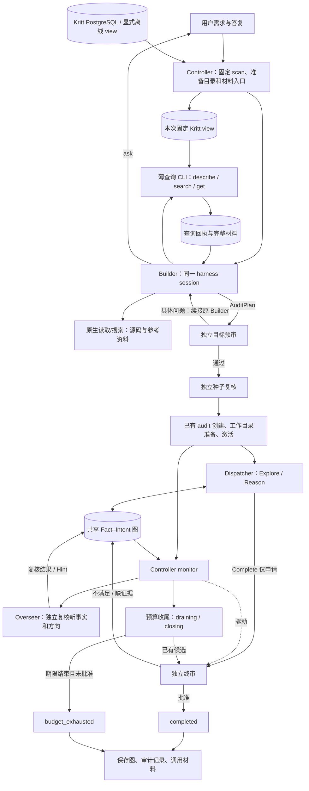

# Kritt Builder 与 audit 融合实现文档

日期：2026-10-10。版本：v0.5。状态：R-CP1 已通过并提交；R-CP2 已验收并提交 `17b6d72`；R-CP3 已验收通过，接回 MVP 完整交付。

本文替代 v0.4，作为 R-CP1—R-CP3 的实施依据。原 generic 交付基线为 `2dd2d3b`；R-CP1 已通过并提交为 `cf749c5`。当前已接通 Kritt Builder 到 audit 研究与监督，R-CP2 已验收并提交为 `17b6d72`，R-CP3 已验收通过。B-CP1—B-CP5 代码、历史结果及验收记录保留，不回退 Git。

本轮进行中等规模的局部重构：修正 Builder 使用 harness 的方式，接回已有 audit 功能。每个检查点完成即停，用户验收通过后才继续。开发检查点不进入产品运行流程，不增加用户审批步骤。

## 1. 目标与范围

用户继续使用一条 `cairn builder` 命令，完成：

自然语言需求 → Builder 自主取材和构建 AuditPlan → 独立预审与种子复核 → audit 研究与监督 → 独立批准或预算结束 → 保存结果。

新 Builder 创建 audit 项目。原生 generic 项目、已有 generic 结果和旧源码型 audit 入口继续可用；不转换历史项目，不给旧 plan 补造 policy 或审核结果。

### 1.1 本轮必须完成

- Builder 在同一 session 中取材、接用户答复、修订方案；通过 harness 的原生文件和命令工具工作。
- 将现有 KrittTools 包为薄本地查询 CLI，程序继续负责固定 scan、分页与材料记录。
- 按角色提供任务信息及文件入口，移除完整文件指纹、参考文档全文等重复 Prompt 注入。
- 接回已有威胁模型/policy、目标预审、种子独立复核、Overseer、完成申请、独立终审、预算和 closing。
- 贯通源码基线、材料、工作目录、进程生命周期与结果保存；修正收尾提示冲突及过时阶段说明。

### 1.2 保留与后置

| 内容 | 处理 |
|---|---|
| Fact–Intent 图、Explore/Reason、Dispatcher、WorkerDriver | 复用，按 audit mode 选择研究提示和结果语义 |
| Kritt 数据适配、describe/search/get、来源引用、分页 | 复用，只增加供 harness 调用的薄入口 |
| 程序侧引用/类型检查、独立审核、预算、取消和清理 | 保留，是实现正确行为所需功能 |
| 已有 digest、lease、有限重试、policy 固定及批准协议 | 保留，不另建一套 |
| 种子复核回执复用、评注导致的重复复核、重复全仓扫描/历史读取 | 第 10 节后置整理，不阻塞三个主检查点 |
| 新 Agent SDK、MCP 平台、通用工具注册层、Driver 能力矩阵 | 不开发 |
| 草案封印、每步人工确认、取材覆盖率门槛、固定三路线门禁 | 不开发 |
| 创建幂等表、跨进程对话恢复、多控制器接管、自动重启 | 不开发 |
| 准备累计额度、硬 Token 上限、额外审核开关 | 不开发；复用现有单次执行时限和 audit 预算 |
| 自动联网文档/CVE采集、新 scan 自动 checkout、运行中同步 Kritt、PoC/报告生成器 | 不进入本轮 |

不修改数据库结构和审计完成协议，不另建研究模式或 UI。只增加与本次改动直接相关的验证，不重新执行历史全部验收矩阵。

## 2. 职责与能力边界

本机调查基线为 Claude Code 2.0.37、Grok Build 1.0.46。两者均具备文件/命令工具和 session 续接；本轮依赖这些已有能力。实际参数由 Driver 适配，不在 Controller 写死 harness 名称。默认配置可保持 claudecode，Grok 使用现有 Worker 引用切换。

| 部分 | 负责什么 | 不交给它的工作 |
|---|---|---|
| Agent | 选择资料、理解代码、分析条件、构建方案和评价证据 | 生成文件哈希、分配数据库 ID、决定持久状态是否已批准 |
| Harness | 工具循环、文件搜索/读取、命令执行、会话和上下文管理 | 替代 Cairn 的项目状态与跨角色调度 |
| Prompt | 本次目标、角色、关键约束、资料/工具入口、输出契约 | 存放完整数据库对象、文件指纹和历史开发阶段规则 |
| Kritt 查询模块 | 固定 scan 查询、关系展开、分页、引用身份、回执和材料落盘 | 判断候选是否为已确认漏洞 |
| Controller / Dispatcher | 角色调用、用户交互、任务调度、期限、取消、进程和产物管理 | 逐次替 Agent 决定读哪个文件或执行哪次检索 |
| Server / audit 协议 | 图和状态持久化、证据依赖、完成申请及独立批准 | 用进程退出码代替语义验收 |

文件哈希清单属于程序核验数据，不要求 Agent 阅读。短小且立即需要的任务信息直接提供；长材料使用路径按需访问，不能只是把大 Prompt 写成文件后再要求全文读完。

源码只读要求属于任务约束；实际工具权限沿用当前 harness 和执行环境，不把 Prompt 描述成操作系统沙箱。Kritt DSN 继续仅供程序读库，过滤出 Agent 及子服务环境；薄查询 CLI 只读本次已保存视图，不取得数据库凭据。

## 3. 运行结构与会话关系



| 工作关系 | session 约定 |
|---|---|
| Builder 自主取材 | 一次调用内部由 harness 循环使用工具，查询不再结束 Builder 调用 |
| Builder 提问后的用户答复、预审修订 | 续接原 Builder，保持同一 Worker 与工作目录 |
| 一次输出的有限格式修复 | 可续接产生该输出的 session，不重启研究或重新选 scan |
| 一次 Explore 与其 conclude | 沿用已有同 session 续接 |
| 不同 Explore / Reason 任务 | 沿用现有独立调用 |
| 预审、种子复核、Overseer、Closing、终审 | 分别发起独立审核/结案调用，不续接被审 Builder 或研究 session；终审也不续接 Closing |

`builder/reviewer` 是 Worker 角色引用，不是一人一模型要求。同 harness 可以使用不同 session 完成独立审核；不同模型可配置，但不新增强制启动条件。

### 3.1 共享调用入口的最小调整

为 `controller.app.call_agent()` 增加可选的已有 session 输入：

- 未提供时保留当前 `prepare_session → build_execute` 行为。
- 提供时复用已有 `build_conclude` 所生成的 resume 命令；该方法当前已经承担 CLI 续接，不需要先重命名所有 Driver 或新建会话框架。
- 场景语义由本次 Prompt 决定，续接不等于进入 Explore conclude。
- 调用结果继续记录真实 session、Prompt、stdout/stderr、耗时与解析结果。不能只重用 `--session-id` 来假装续接；Grok 对已存在 session 要使用 resume。

保留 Pydantic 结果解析和已有一次格式修复。暂不统一各 harness 的原生 JSON Schema 功能；本机 Claude 与 Grok 的相关参数并不完全一致。

Builder 状态放在本次 Python 调用上下文及现有运行文件中，包括 session、workspace、最终 plan 路径和用户问答。不同 run 的 session 不共享，不能在通用调用入口设置进程全局的默认 session；不开发跨进程恢复入口。CLI 异常退出后保留材料并报错，操作者使用新 run-dir 重跑。

`controller.timeouts.build` 限制一次自主 Builder 调用，包含其内部查询和读文件过程；不会因每次 Kritt 查询而重置。用户答复、预审修订属于下一次已有调用。格式修复共享本次剩余时限。不新增准备总预算。

## 4. Kritt 取材作为 harness 工具

### 4.1 准备一次可查询视图

Controller 沿用 `read_kritt_view()` 或显式 `--view` 选择一个 scan，使用 `verify_source()` 对齐源码，然后复用 `KrittView.save()` 保存本次 `kritt-view.json`。原始离线 view 也保存为本次可查询视图，不在查询时回库或重新选 scan。

本次目录提供：

- `kritt-context.json`：查询入口使用的 view 路径、查询输出目录及沿用的 profile/读取/响应限额；不含 DSN。由程序生成，不要求用户填写。
- `requirements.json`：原始需求与用户答复，供独立预审和复盘使用。
- `source-baseline.json`：完整核验结果，仅供程序使用。
- `references.json`：提供资料的来源路径及可读副本位置；资料复制一次放到 `references/`，保留原文，不逐轮注入。
- 查询命令的绝对 Python 路径、模块和 context 路径，以及简短用法。源码路径和可用资料入口明确传给 Builder。

仓库内自行发现的安全/部署文档通过源码路径引用，不另做全仓文档复制。

### 4.2 薄 CLI 的功能契约

建议新增 `controller/kritt_query.py`，由 harness 的原生命令工具调用。内部命令形状如下，名称可在同一实现内微调，但不增加用户启动参数：

```bash
<本次 Python 绝对路径> -m cairn.controller.kritt_query   --context /本次目录/kritt-context.json <<'JSON'
{"action":"search","kind":"flow","path":"module/install/"}
JSON
```

JSON 通过 stdin 传入，复用现有 `KrittTools.execute()` 和 action 类型。这个命令是 Agent 可调用工具，不是用户每次必须手工运行的新步骤。

| 动作 | 行为与返回 |
|---|---|
| describe | 返回目标身份、记录概况、字段及查询用法；不返回全量数据 |
| search | 沿用 kind、terms、path、fields、effect、coverage 等实际筛选能力，返回有界摘要、原始 ref、next_cursor 和回执路径 |
| get | Agent 提供已有 ref；工具内部从头拉完该记录及既有关联的全部分页，保存完整材料；stdout 返回记录身份、数量和材料路径 |

`route` 不影响现有检索结果，不再要求 Agent 选择。包装层可为旧 SearchAction 填内部兼容值，保留旧 probe 接口，避免扩成 schema 重构。字段/机制词说明只提供一份，不在 description、顶层字段和首轮结果中重复注入。

search 的分页 cursor 仍由 Agent 按需要使用；get 的分页由工具完成，不要求 Agent 管理分片。保留已有记录身份、哈希和来源检查，不要求模型计算哈希或自行推测 ref。

每次查询自动建立独立 `queries/<query-id>/`，保存回执、结果摘要和 get 的完整材料。query-id 由程序生成，只用于文件定位。正常退出返回机器可读 JSON；查询错误返回简短错误及非零退出码，供 Agent 在当前工具循环中修正。失败或不完整查询不能登记成完整 get 材料。

### 4.3 材料聚合与退出

`KrittTools` 的 ledger/分片状态属于单次查询进程。get 在该进程中完整结束，再保存自己的 receipts/materials；不能每次新建工具后覆盖同一总回执文件，导致前次记录丢失。

Controller 在 Builder 返回及结束准备时，汇总本次 queries 目录，继续生成 `query-receipts.json` 和 `selected-materials.json`。按已有 ref 身份合并重复材料；保留不同查询回执。预审修订发生的新查询也要汇总，不能只保存初稿材料。

查询文件写出后即能供同 session 及后续角色读取，不依赖模型把全文复制进最终输出。中断时保留已经生成的逐查询产物，总汇总文件可能不完整。沿用本次进程组取消和回收，覆盖 harness 启动的查询子进程。

材料已完整返回给程序，不等于 Agent 已经读过，也不等于证据已验证。只使用 search 摘要时允许继续构建方案，完整 get 材料可为空；保存摘要来源和回执，不增加读取率或固定路线门禁。

## 5. Builder 输出与威胁模型

### 5.1 ask / finish 与 AuditPlan

移除生产 Builder 外层的 `query` 动作，查询改由第 4 节的真实工具完成。外层只接收：

- `ask`：少量具体问题。Controller 在当前终端接收答复、保存到 requirements.json，然后续接原 session。非交互运行不能回答时沿用现有报错行为。
- `finish`：顶层复用 `AuditPlan` 字段并附 `action: finish`。程序去掉 action 后得到并保存 AuditPlan；不另建同义方案类型。

| 字段 | 约定 |
|---|---|
| title | 简明项目标题 |
| origin | 任务身份、仓库/版本和用户要求等背景；不是未经复核的代码结论 |
| goal | 忠实于用户意图的可接受目标，不加“或证明不可能”出口 |
| policy | 复用 AuditPolicy 的 effect、deployment、attacker_capabilities、scope、cvss、evidence_requirements、threat_model |
| seeds | 复用 AuditSeed / AuditFactData，保留主张、源码证据、条件和 premise_ids |
| intents | 复用 AuditInitialIntent，from 使用 seed key 或字面量 origin |
| hints | 统一使用已有 CreateHintInline；通常可省略，程序补固定材料入口提示 |

程序在独立种子复核前强制 `review_status=unverified`，不接受 Kritt 或 Builder 的自报确认。独立种子复核后的状态由已有流程处理，创建前不能再次一律覆盖为 unverified。源码引用可为空，缺证据进入后续研究，不伪造行号。

保留 key 唯一、引用合法和无环依赖等已有协议要求。种子和 Intent 数量保持少而明确，不恢复固定检索路线或覆盖率约束。关键 Kritt 记录身份及条件写入描述/材料，不新增 provenance 业务表。

**origin 不作为证据入口。** 代码行为、匿名可达性、部署状态和危害判断必须进入普通 seed，不能藏入 origin 绕过种子复核。Builder 和既有预审共同遵守此约定，不新增 Origin Reviewer。

`plan.json` 保存最终采用的 AuditPlan；预审修订更新该文件，原始返回和每次修订保存在 call/stage 原文中。历史 generic plan 不自动升级，也不作为本入口的恢复输入。

### 5.2 威胁模型和条件

Builder 可为开题定向阅读提供的资料、仓库安全/部署文档、默认配置和必要路由/鉴权源码。完整利用研究交给 Explore，不在开题阶段部署目标或执行 PoC。

沿用 `policy.threat_model` 列表，条目统一表达：

```json
{"claim":"具体部署、攻击者或边界判断","kind":"official|inferred|unknown","source":"资料位置、代码依据或缺失原因"}
```

official 用于官方文档明确声明的规则或边界；用户提供文件、文件名叫 SECURITY、或源码来自官方仓库，都不能自动证明某项判断是官方威胁模型声明。源码观察及分析归入 inferred，保留依据；unknown 写明未知及后续验证方向。没有官方模型可以继续；只有会改变可接受范围或导致任务无法开展的信息缺失才询问用户。

用户要求“匿名”可固定为攻击者无账号；某个入口是否匿名可达仍是待证明事实，不能偷偷写成固定 policy 中的已知能力。已有 rank、canonical、valid、scope 和历史 CVE 只作线索，不自动证明当前版本或官方接受范围。

CVSS 沿用现有指标及 any_of/all_of 匹配，例如：

```json
{"AV":"N","PR":"N","UI":"N","any_of":[{"C":"H"},{"I":"H"}]}
```

部署、效果、攻击者能力和范围单独写入 policy，CVSS 不替代这些条件。有 CVSS 约束时终审提供完整向量；仅作源码/条件梳理且 `cvss={}` 时允许 `cvss_vector=null`。不新增评分器，不擅自补最宽或最严指标，不靠条款优先级改变用户目标。

## 6. Prompt 与按需读取

### 6.1 输入组织

所有角色只直接获得本次需要的短信息：任务、关键约束、当前对象/来源 ID、资料和工具入口、必要输出契约。以下材料保存为文件按需读取：方案、参考文档、查询结果和研究图。

完整 `baseline.files` 不进入任何 Agent Prompt，也不进入要求 Agent 阅读的 input/graph 内容。尤其要处理三条实际路径：

1. 旧 audit.stage 的 context.baseline。
2. monitor 的 node_input 及 ProjectDetail 序列化。
3. audit YAML export 当前同样内嵌 audit.baseline，不能原样作为 Agent 图文件。

在模型输入边界提供小的共享视图转换：基线只保留 repo/commit、digest 等定位信息，图保留 policy、事实、条件、状态、Intents、Hints 和判断所需关系。完整 Server 元数据、程序核验基线、最终归档导出不因此删字段。程序提交仍使用 Server 返回的原始 input_digest/proof_digest；不能把模型展示视图的摘要冒充服务端绑定摘要。

输出 schema 可以作为紧凑契约保留；较长说明提供文件入口。既不重复塞多份字段定义，也不省略模型正确返回所必需的信息。不通过新字节门槛、静默截断或更换 stdin 来继续喂入全量资料。

### 6.2 各角色的阅读与结果

| 角色 | 本次输入与自主读取范围 | 结果 |
|---|---|---|
| Builder | 需求与答复、查询工具、源码和资料入口；开题所需定向阅读 | ask 或 AuditPlan |
| Preflight | 原始需求/答复、当前完整方案、相关政策依据；不重新做整项研究 | 通过或具体歧义 |
| Seed reviewer | seeds、固定条件、源码和材料入口；独立检查主张与实际路径 | 每个 seed 的支持、反证或未知 |
| Explore | Current Intent、from IDs、policy、图及材料入口；按关联事实和源码深入 | 增量观察、证据、条件和前提 |
| Reason | 全局进展、开放任务、事实/状态、Hints；可访问完整研究图 | 新任务、等待或完成申请 |
| Overseer | 当前节点、必要前提、policy 与证据入口；按需核对源码 | 节点复核和必要 Hint |
| Closing / 终审 | 最终图/申请、证据闭包、policy 与原始材料；只读已有成果 | 候选整理 / 独立裁决 |

取消“每个 Explore 必须完整读图”。保留完整图可访问性，让 Agent 从当前 Intent、来源和相关 Hint 定位，按需扩大阅读。Reason、Closing 和终审需要跨事实判断，不能以缩短上下文为由删除其可访问的完整图。不建设图检索服务。

Explore conclude 续接已有 session，只总结已经获得的观察和未确认项；不再新建 Graph 文件并要求读取，也不派新工具任务。修正共享 helper 与 default/audit 收尾模板中的冲突，保留各模式原来的结果语义。

删除 audit reason 中“当前 CP3 不具备完成申请能力”等历史文字，明确 Complete 仅申请。预审修订必须带当前 plan 和 issues，不能新开空白 session 重新开题。

### 6.3 Builder 短正文基准

动态路径、查询用法和输出 schema 由程序提供，正文不重复展开：

> 根据用户需求，利用提供的只读 Kritt 查询工具、参考资料和源码，构建审计方案。保留用户要求的效果、部署、攻击者能力和范围。
>
> 自主选择开题所需的查询和阅读。区分官方依据、推导与未知；已有 finding 和复核标签是线索，代码行为及可达性判断进入待复核 seeds，origin 只放任务背景。不要修改源码、部署目标、执行利用实验或自行调用子 Agent。
>
> 缺少会改变任务范围的关键信息时简短提问，否则返回 AuditPlan。Goal 不加入“证明不可能”出口；保留必要条件，CVSS 不替代部署与效果。
>
> 最终只返回契约规定的 ask 或 finish JSON。收到 preflight_issues 时针对当前方案修订，保留用户意图和已有取材。

独立审核提示保留其具体裁决职责，只修必要的上下文和阶段文字，不复制一份不断增长的通用审计清单到所有角色。

## 7. 接入已有 audit 准备与研究

### 7.1 共享准备入口

在 `controller/audit.py` 抽出接收已生成 AuditPlan 和现有上下文的小函数，复用预审、有限修订、种子复核、创建、材料准备、记录和激活。

- 旧源码型入口先运行原 build，再交给共享流程。
- Kritt 入口交已有 plan，不再调用旧 build 丢失取材。
- 修订通过一个小的调用回调交给原 Builder；上下文保留原始需求/答复、plan、资料和 issues。不新建控制器父类或通用流水线系统。
- 沿用 `max_goal_revisions`；失败显示具体问题并结束，不增加第二轮人工草案审批。

种子复核沿用 `SeedReviewResult` 和 `apply_seed_reviews()`。证据不足保留 unverified，反证才 refuted；执行失败记录错误，不当成反证。空 seeds 时跳过没有对象的种子模型调用；存在未确认种子时沿用旧验证 Intent 行为。完整种子审核回执复用优化在第 10 节后置，主链先保留现有可靠行为。

### 7.2 源码基线贯通

复用已保存的 `source-baseline.json`，提供共同检查入口：

- Kritt 基线带 source_manifest，沿用完整归档及 manifest/文件变化检查。
- 旧源码型基线不带 source_manifest，保留 repository_baseline 行为。
- 覆盖 audit 准备、Dispatcher、monitor 所复用的 research_workspace、Server 终审批准位置。

只抽取必要底层 helper，避免基础模块反向依赖 Controller；不建设基线策略类。无 .git 的归档使用已核对的 scan/manifest commit，不通过上层 Cairn 仓库的 git rev-parse 获取目标版本。Kritt 引用通过已有 normalize_source_path 归一为实际相对路径，再进入 audit 引用核验。

### 7.3 创建、材料、激活

1. 沿用本次独立 Server 启动和自动端口。
2. 完成预审、有限修订及种子复核，以 CreateAuditRequest 调用已有 create_audit。
3. 保存 Server 返回的 seed_ids 和项目定位，项目维持 stopped/preparing。
4. 准备 `work/<project>/repo`、kritt-materials.json、research-context.json、参考资料入口和匹配 input.json。
5. input.json 保留 project_id、repo_path、policy_digest；附必要材料路径，不放完整文件清单，不改变激活契约。
6. 调用 start_audit，开始既有绝对预算期限。
7. 启动 Dispatcher 及 `cairn audit --project <id>`；前台管理进程与进度。

不再用 generic create_project 加多次 conclude 模拟种子导入。先准备工作目录再激活和调度，避免 Worker 看不到源码或材料。

monitor 进程按现有 `controller` 键登记并输出 controller.log，复用 stop_processes 对 controller/dispatcher/server 和其 Agent 的回收。启动失败或运行期 monitor 异常退出必须停止本次项目并保存错误，不能继续无监督研究。终态后正常退出与异常退出分别处理，避免把完成后的正常退出误报为故障。

## 8. 运行、结案与结果

| 项目状态 | 前台行为 |
|---|---|
| active | 研究与监督运行，显示进度 |
| draining | 继续等待在途收尾和独立结案，不关闭 Server/monitor |
| completed | 独立批准后导出结果、清理进程 |
| budget_exhausted | 未获批准且既有期限结束；保存成果，不解释为无漏洞 |
| stopped | 保存用户停止或错误停止时的实际图和错误 |

`finalizing` 是 audit.phase，项目 status 仍为 draining。沿用 research/drain/final review 三段绝对期限，closing 只读最终图，不启动新探索。Complete 仍仅生成申请；保留独立 session、证据闭包、CVSS 匹配、执行错误与实质性驳回的区别。

Ctrl+C、SIGTERM、服务退出沿用现有取消和进程清理。只管理本次拥有的进程；在 Server 可用时保存已取得结果，再清理。不中途自动重建项目或重置期限。

### 8.1 运行目录与追溯

| 文件/目录 | 用途 |
|---|---|
| run.json、requirements.json | 原始需求/答复、目标、scan/commit、Builder session 和准备产物定位 |
| kritt-view.json、kritt-context.json | 本次固定查询数据和程序生成的工具上下文 |
| source-baseline.json | 完整源码指纹及 manifest 来源，供程序核验 |
| references.json、references/ | 参考资料索引、原来源及一次性保存的副本 |
| queries/、query-receipts.json、selected-materials.json | 各次查询原始回执、实际返回和完整 get 材料，以及汇总 |
| plan.json、call-*/、已有 stage 目录 | 最终方案及构建/修订/审核原始调用 |
| project.json | 项目 ID、Server seed_ids、工作目录和初始图定位 |
| research.json | 地址、进程、audit phase、真实状态、结果路径及错误 |
| result.json、graph.yaml、timeline.txt | 最终项目详情、原有图导出与时间线 |
| audit.json、completions.json | 已有 audit 记录、closing 和完成申请/裁决 |
| cairn.db、server.log、dispatcher.log、controller.log | 本次数据库与服务日志 |
| work/<project>/research、controller-reviews | 沿用 audit 研究与复核原始 Prompt、session、stdout/stderr |

工作目录中的材料入口必须同时供研究和复核访问，不能只存在于 Builder 私有日志。最终 graph.yaml 继续使用现有归档导出，区别于第 6 节提供给模型的图视图。源码仍为引用；保留原源码及 manifest，不声称运行目录包含完整执行环境或可以逐步重放全部工具过程。

## 9. 配置与兼容

用户命令形状不变，不新增 mode、prepare-only、approve、resume 等产品参数：

```bash
uv run --project cairn cairn builder   --config dispatch.builder.yaml --target zentao --scan-id 19   --goal '梳理指定入口的鉴权与终止条件，提供源码证据，仅做静态研究。'   --run-dir /absolute/path/to/new-run
```

完成接回后此命令创建 audit；当前代码仍创建 generic。内部 kritt_query 命令由程序生成用法，用户不必配置 Python 路径或查询产物位置。

示例保留 local、自动端口、单 Worker；增加已有 `controller.research_prompt_group: audit`，保留 `runtime.prompt_group: default` 服务普通项目。使用既有 roles、timeouts、max_goal_revisions、review、budget 字段，只显式展示日常需要调整的值。

Kritt 的读取/响应限额从现有配置传给薄 CLI，避免 view 在父进程可读、工具进程却误用不同默认值。原探针的 max_queries/max_agent_calls/probe_seconds 保留在探针，不重新套到生产 Builder。默认 claudecode；Grok 通过 Worker 类型与角色引用选择，复用本机登录和模型配置。

旧源码型 audit、普通项目、已有结果查看继续工作；不要求其他 Driver 先完成全套原生 schema 或 MCP 接入才能交付。

## 10. 后置整理：不阻塞主链

下列工作另列小提交，在主链验收完成后按实际需要实施。本轮不为了提前完成它们增加状态表、缓存系统或新审核接口。

| 整理项 | 最小方向与边界 |
|---|---|
| 种子复核结果复用 | 将独立 seed_review 结果绑定到映射后的具体 Fact 和对应输入，再供 monitor 识别；保留来源 session 和原始回执。不能仅凭 verified 字段跳过，也不能标记未执行过的审核成功 |
| 纯评注触发重复审核 | node_input 的前提视图排除 review_notes，保留状态、证据、条件、依赖及验证层次；实质变化仍触发 |
| 全历史重复读取 | 每轮获取一次 records 并加入本轮新记录，保留既有 input/output digest 去重 |
| 无待办和相邻全仓扫描 | 避免无待办轮询的全扫及入口与首个调用的紧邻重复；保留执行阶段必要检查、引用核验及 Server 批准前基线检查。未测量前不做增量指纹平台 |

本轮必须解决大材料输入、会话断裂和职责冲突；上述成本优化不成为 R-CP1—R-CP3 的放行前提。

## 11. 开发任务与停止检查点

### R-CP1：Builder 正确使用 harness，形成审计方案

**确定性代码：** call_agent 支持续接；保存固定 Kritt view、需求、源码基线和参考资料；薄 CLI 复用查询与完整 get；逐查询保存及汇总；Builder 外层改为 ask/finish，同 session 接答复；输出采用 AuditPlan。隐藏无行为 route，去掉参考全文重复注入。

**Prompt：** 开题定向阅读、工具入口、来源/推断/未知、origin 与 seed 区分、policy 和输出契约。本文第 6.3 节作为短正文基准。

**必要验证：**

- 一次真实 harness 在指定版本源码和 Kritt 材料上自主调用薄 CLI，读取所需文件并返回可解析 AuditPlan；保留实际工具调用、查询材料和 session 记录。
- 少量确定性用例验证 ask 后续接、格式修复不重开研究、reviewer 默认新 session、连续两次查询不覆盖回执、get 分页材料完整保存。
- 使用现有大参考资料/源码清单体量检查模型输入只包含所需短上下文，不需要调用模型反复测试容量。

此点只完成准备能力。通过 `run_builder` 或本地开发测试脚本验收，不新增 prepare-only 用户参数。新 AuditPlan 不得交给尚未改造的 generic import；若公开 builder 命令已切到新准备实现，CP1期间明确返回“接回尚未完成”，不得静默启动 generic。当前使用指南仍标记未交付。

**停下交接：** 修改摘要、运行命令、实际结果、run-dir；用户通过后才进入 R-CP2。

### R-CP2：audit 研究与监督接通

**确定性代码：** 抽出共享准备入口；Kritt plan 接预审与种子复核，修订回到原 Builder；使用已有 POST /audits、seed_ids、工作目录、激活及 monitor；基线贯穿准备/研究/终审；模型输入和 audit 图视图不带完整 files；active/draining 持续管理。

**Prompt：** 按角色提供材料路径与必要上下文；Explore 按相关事实读取；conclude 只收已有结果；Reason 使用当前完成申请语义。旧源码型入口继续复用共享流程。

**必要验证：**

- 真实 audit Explore 写入新 Fact，Overseer 实际处理该 Fact；可以主动 stopped，不要求本点完成终审。
- 针对性用例确认没有重复旧 build、修订保留当前 plan、材料可读、源路径/基线一致、generic 提示未被全局替换。
- 使用真实 scan19 清单体量覆盖预审/种子复核/Overseer/Closing/终审的输入构造，以及研究图文件，确认 files 不会通过嵌套字段回到 Agent 输入；无需为每个阶段重新调用真实模型。
- 验证 conclude 提示不再同时要求禁用工具和读取新文件，monitor 使用既有进程回收键。

**停下交接：** 记录项目 mode、实际 Fact/复核结果和停止后的状态；用户通过后才进入 R-CP3。

### R-CP3：独立结案、预算与交付

**确定性代码：** 完成终态等待、audit/completions 导出、进度和错误显示；同步配置与实际使用指南，复用已有停止清理。程序已经具备的审核协议不重写。

**Prompt：** 仅补联调确认的必要歧义，检查提示词与当前功能一致，不因一次失败无限追加规则。

**必要验证：**

- 一次真实有限静态任务，经完成申请与独立终审达到 completed；不要求找到真实 RCE。可沿用 scan19 现有源码和可用材料，cvss 可为空。
- 确定性流程覆盖预算结束、draining期间最后成果、用户停止及自有进程退出；使用既有合成响应和短预算即可，不消耗模型做故障矩阵。
- 核对结果文件能区分申请与批准、completed 与 budget_exhausted，原始调用和源码/材料定位可追溯。

真实验收优先覆盖本次选用的一个 harness。另一个继续相关 Driver/续接回归；没有调用真实供应商时明确说明，不要求双模型完整重复演示。离线 view、在线 PG、真实模型和假 CLI 证据分别标注。

**停下交接：** 用户验收通过后本轮交付完成。第 10 节后置项不自动转为新的开发阶段。

## 12. 改动地图与文档效力

| 位置 | 改动 |
|---|---|
| controller/app.py、builder.py | 可选 session、Builder自主取材/交互、AuditPlan、准备上下文 |
| controller/kritt_query.py（新增薄入口）、kritt.py、kritt_tools.py | 复用固定view/query，工具命令、材料保存与包装适配；不重写读库 |
| controller/audit.py | 共享方案准备、修订回调、旧入口复用 |
| controller/research.py、cli.py | audit初始化、进程/终态管理及结果导出 |
| audit_evidence.py、controller/kritt_source.py | 必要共同基线检查，保留两种来源语义 |
| dispatcher/tasks/audit.py、common.py、explore.py | 模型可读上下文/图、按角色读取与conclude修正 |
| controller/monitor.py、server/audit_review.py | 材料输入与共同基线调用；审核协议继续复用 |
| Controller / Dispatcher 提示词 | 短任务委托、按需读取、修订与完成申请语义 |
| 现有 Builder/audit 测试、配置及指南 | 衔接回归、真实使用和模式说明 |

预计涉及十几个 Python 文件及相关提示词、少量测试/配置。按一位熟悉仓库的开发者粗估 5—8 个工作日，含针对性验证和真实联调，不含等待用户验收；这是静态估算，不是固定排期。

[kritt-builder-mvp.md](kritt-builder-mvp.md) v0.3 保留为已交付历史，其“不接 audit”等规则不再约束本轮。[audit-controller-mvp.md](audit-controller-mvp.md) 用于复用已实现语义，不重新开发历史 CP1—CP6。[server-protocol.md](server-protocol.md) 的 generic 直接 Complete 不用于新审计批准；[dispatcher-design.md](dispatcher-design.md) 的共享调度和 harness 继续适用。

README 和使用指南按已完成检查点说明实际行为及未完成部分；R-CP3 前统一标注“接回尚未完整交付”，不在 R-CP2 已接通 audit 后继续声称当前入口为 generic。R-CP3 完成后更新为正式 audit 用法。本轮不承诺自动获取官方资料、完整动态漏洞验证、Token总计量或全量可重放环境。
