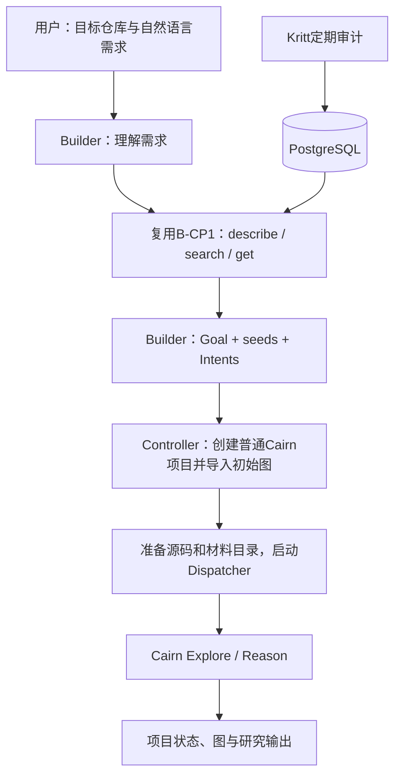

# Kritt 驱动的 Builder MVP 开发约定

日期：2026-10-07。版本：v0.3，记录已交付的 generic 正向功能流程。

**2026-10-10 更新：B-CP1—B-CP5 已完成。后续开发改按 [Kritt Builder 接回 audit 的 MVP 方案](kritt-audit-reconnect-mvp.md) v0.5；本文件下文保留为 v0.3 历史范围，不再作为后续开发指令。R-CP1、R-CP2 已验收并提交，R-CP3 已验收通过。**

## 1 范围

Kritt自动定期审计并更新数据库。Builder是用户的CLI交互入口，使用B-CP1已有工具读取Kritt结果，生成Goal和初始任务图，再交给Cairn研究。用户无需手工导出数据库、挑选findings或编写seeds。

后续只开发需求输入、取材、构图、创建项目、研究运行和结果展示。移出原计划的Goal对抗预审、独立种子复核、检索路线完成判定、来源硬门禁、目标/草案封印、创建去重、断点恢复、新增准备/移交预算，以及稳定性和故障矩阵。同步删除为这些步骤增加的参数和状态。

B-CP1已有只读连接、查询、源码支持和执行能力直接复用。现有Cairn接口所需的数据格式、运行配置及进程管理沿用，不在后续阶段扩建检查体系。代码运行报错时显示错误原因并结束本次操作，由操作者重新运行。

## 2 正向流程



1. 用户输入目标仓库和自然语言需求；确实缺少无法开展任务的信息时，Builder在当前CLI会话中提问。
2. 指定scan时使用该scan；未指定时，复用B-CP1按目标仓库选择已完成扫描的方式。继续使用该次读取的材料。
3. Builder根据需求查询入口、Flow及相关findings，按需要展开父链、重复组和已有分析，选择研究材料。
4. Builder输出一份任务方案：目标、背景、种子Facts、Intents和供Worker使用的材料。
5. Controller把方案写入Cairn，准备源码与材料路径，随后启动Dispatcher。
6. Cairn正常执行Explore/Reason；用户可在现有页面查看图，在终端查看项目状态，并保存研究输出。

## 3 Builder：提示词与最少代码

### 3.1 Agent接入

继续复用Cairn的`call_agent`、WorkerDriver和执行器，角色引用已有Builder Worker，首版配置claudecode。应用层按模型返回的“提问、查询、完成方案”执行对应操作，无需新增Agent平台、SDK或网页会话服务。

Builder可以在当前调用链中保留用户答复和查询结果。任务结束后只保存后续启动与查看结果所需的文件，不开发跨进程对话恢复、revision状态机或草案审批。

### 3.2 提示词

> 你是Cairn Builder。根据用户的审计需求，使用提供的只读工具查询Kritt已有结果。优先从入口和Flow理解执行过程，结合相关findings选择值得继续研究的方向。保留用户指定的部署、身份和效果要求，把材料中的前置条件、未知项和源码位置写入研究上下文。信息不足以开展任务时简短提问。输出项目标题、背景、Goal、种子Facts和Intents，供Cairn继续研究。

RCE、信息泄露机制词和已有字段说明作为取材预设提供给Agent，不要求完成固定路线，不增加反证审核回合。资料中的已有复核结论可以作为上下文读取，不触发新的Reviewer调用。Goal可以包含用户要求的具体条件，不强制引入CVSS向量或单独的GoalPolicy对象。

### 3.3 必要输入与输出

| 数据 | 用途 |
|---|---|
| Cairn配置与Builder Worker引用 | 调用现有harness和运行服务 |
| 目标仓库配置、源码路径 | 选择Kritt目标并让Worker读取实际源码；沿用B-CP1的配置格式 |
| 用户需求、可选scan ID | 形成目标并选择已有扫描 |
| 运行目录 | 保存方案、选用材料、项目ID和研究输出 |
| 可选参考资料 | 用户已有部署/安全说明直接作为任务上下文 |

任务方案采用一个简单的可解析JSON对象，不再拆分GoalPolicy与GraphDraft：

| 字段 | 用途 |
|---|---|
| `title`、`origin`、`goal` | Cairn项目标题、已有背景与研究目标 |
| `seeds[].key`、`seeds[].description` | 初始Facts；key用于生成真实Fact ID前的连接 |
| `intents[].from`、`intents[].description` | 从哪些种子开始，下一步研究什么 |
| `hints`（可选） | 交给Worker的补充说明 |

scan/commit、源码路径、选用记录的ID与条件随背景或材料文件保存，便于Worker接着研究。只保留工具调用和Server入参实际需要的字段解析、ID转换及错误返回；不增加一轮证明“方案合格”的流程。

不再增加request_key、policy/plan/rules digest、读取证明映射、revision、阶段允许动作表、预审次数、复核次数、准备累计额度或移交期限等参数。B-CP1内部已经使用的参数和材料格式不要求回滚，后续功能不再叠加同类参数。

## 4 接入Cairn普通研究流程

### 4.1 项目类型

本条MVP路径创建Cairn普通研究项目（generic），使用原有Explore/Reason及普通Complete，研究提示词使用现有普通项目的prompt group。旧audit模式的Overseer、完成申请和独立终审属于另一条已有路径，本次Builder不接入这些环节；已有audit功能保留。

不能仅关闭audit模式的monitor再等待completed：该模式本来依赖审核才能完成。本版采用普通项目路径，使创建、研究和完成按原有正向机制运行。

### 4.2 初始图导入与启动

当前`POST /projects`能创建title/origin/goal/hints，但不能直接接收整张种子图。B-CP3需要补齐一个小型Controller导入函数，复用现有接口：

1. 启动本次本地Server，Dispatcher暂不启动。
2. 创建普通项目，`bootstrap_enabled=false`，因为初始材料已由Builder提供。
3. 对每条seed创建一个标明“导入Kritt材料”的Intent，并用既有conclude接口写成Fact；保存seed key到实际Fact ID的映射。这是数据导入，不作为一次Explore或证据核实。
4. 用该映射创建Builder提出的研究Intents，并写入材料路径等Hint。
5. 通过现有LocalBackend准备项目工作目录，将目标源码和选用材料放在Worker可读取的位置；随后启动本次Dispatcher。

此启动顺序适用于本地单次运行入口，避免Dispatcher在导入过程中读取半张图。普通项目创建后立即active是现有接口行为；文档不假定它已有stopped或批量seed入参，也不新增审核状态。首版不处理向已运行的共享Dispatcher热插入半成品项目。

Controller不再调用旧`create_local_audit()`整条流程，不设置伪造的审核通过或verified状态。若API客户端缺少上述普通创建方法，只补对应HTTP调用即可。

### 4.3 运行与结果

研究沿用Cairn现有Worker、调度和配置。普通Reason自行判断研究完成并调用Complete；用户也可用已有项目停止操作结束研究。后续不新增独立监视Worker、结案审核、项目总额度或暂停/恢复预算。

终端输出Server地址、project ID、运行目录和项目状态。保存`plan.json`、选用材料及项目定位信息；通过已有项目查询和导出接口保存图与时间线，继续使用现有Cairn页面查看成果。既有harness调用时限和进程停止/清理直接复用，不另做控制框架。

## 5 B-CP1已完成记录

B-CP1已经提供只读数据与取材探针，提交为`1517a31`。下面保留原验收范围，作为已完成记录，不转成B-CP2之后的新增工作：


- 核对原MVP基线与相关测试；候选代码固定路径/hash后验收，不拿开发者报告代替独立检查。
- 固定scan19夹具核对32入口、296 Flow、334原候选、152canonical/182duplicate、90无候选Flow。在线读取记录当次manifest与差异，不要求持续更新的库永远保持旧计数。
- 同commit完整源码及导出依据齐全；错commit/缺源码/兼容错误在模型开销前可诊断。只读事务/权限在隔离库验证，不在现有业务库尝试写入。
- 真实claudecode实际提出查询，完整get后自行读取源码并返回可核对片段；预置完整答案或重放输出不能代替。记录harness及实际后端模型。
- 验证分页、分片、截断、无命中、非法引用、DSN不进入Agent环境；所有执行受预算限制。

## 6 B-CP1之后的开发顺序

保留B-CP2至B-CP5作为交付分段，完成一段后停下交接。每段只展示本段功能的实际正向结果，不新增审核关卡、重复试跑次数、故障注入、完整回归矩阵或快照证明材料要求。

| 阶段 | 提示词部分 | 必要代码 | 本段交付 |
|---|---|---|---|
| **B-CP2：生成研究方案（D3—D4）** | 理解用户需求；按需提问；查询Kritt；生成Goal、seeds和Intents | CLI输入；复用查询工具与harness的简单调用循环；保存方案和选用材料 | 输入真实需求，得到可用于创建项目的`plan.json` |
| **B-CP3：启动研究（D5）** | 在研究上下文中提供源码路径、Kritt材料和用户目标 | 普通项目创建；seed导入和ID映射；Intents/Hint写入；工作目录准备；启动Dispatcher | 真实Explore执行并产生新的Fact |
| **B-CP4：查看与保存结果（D6）** | 沿用现有研究提示词 | 显示项目状态、地址与ID；复用现有页面和导出接口，保存图和时间线 | 用户能查看研究过程并取得输出 |
| **B-CP5：一条命令交付（D7）** | 整理实际使用的Builder提示词与取材预设 | 串起本地Server、Builder和Dispatcher；配置示例；使用说明 | 用一个真实任务演示从自然语言需求到研究输出 |

B-CP2阶段可以直接调用准备函数生成方案；B-CP3接上后，同一正式入口继续创建项目并运行，不为阶段停工新增`--prepare-only`产品参数。最终命令示意：

```bash
cairn builder --config config.yaml --target zentao --scan-id 19 \
  --goal "研究已安装业务态、默认配置下的匿名远程代码执行" \
  --run-dir runs/zentao-001
```

`--scan-id`可省略。首版不提供`--resume`；发生错误时保留已有方案/项目定位和错误说明，操作者重新发起任务。结果展示明确区分已生成方案、正在研究和项目结束。

交接只需说明完成的功能、运行命令和结果位置。已有测试可按开发需要使用，本计划不再把专门的校验系统或大规模测试建设列为B-CP2之后的交付任务。

## 7 实现范围与输出含义

优先复用B-CP1的`controller/kritt*.py`、现有`call_agent`/WorkerDriver、普通项目/Intent/conclude接口、LocalBackend及导出能力。正在进行的B-CP2代码按本版收敛，删除原计划中的独立预审、种子复核、封印、恢复与新增预算流程；不因为已有草稿实现了这些内容而继续将其作为MVP要求。

以下范围也适用于Builder之外的后续模块：

| 模块 | 仍需新增的正向功能 | 直接复用或移出本轮的内容 |
|---|---|---|
| 项目初始化 | 将方案通过现有项目、Intent、conclude接口导入，转换种子ID | 复用Server和SQLite；不新增审核接口、业务表、幂等请求登记或草案版本系统 |
| 工作目录与启动 | 放好源码/材料路径，初始图准备完后启动本次Dispatcher | 复用LocalBackend和进程管理；不新增队列、租约系统、多实例接管或恢复状态机 |
| 研究执行 | 把用户目标和Kritt材料交给已有Explore/Reason | 复用现有WorkerDriver与普通研究提示词；不另建Overseer、终审、预算收尾或Token计量模块 |
| 结果展示 | 打印项目地址/状态，保存现有图与时间线导出 | 复用现有图页面和导出接口；不新增Builder网页、审批面板、置信度评分或正式漏洞报告生成器 |
| 本地交付 | 一个命令串起准备、导入和运行，提供可用配置与说明 | 复用已有停止/清理能力；不新增故障矩阵、重复试跑框架或独立测试平台 |
| Kritt生产端 | 使用已有定期扫描结果 | 不开发扫描调度、持续同步、跨版本合并或新的源码checkout平台 |

Server已有的引用处理、Worker认领/心跳、JSON解析，以及harness的调用时限和进程回收，是现有运行机制，继续复用，不作为新一轮模块建设。停止前Worker历史等可观测性扩展不列入本轮。

后续范围统一以本文为准。[旧审计控制器方案](audit-controller-mvp.md)记录已完成的audit路径；[Server协议](server-protocol.md)和[Dispatcher设计](dispatcher-design.md)描述已有能力，不能将其中历史任务或可选增强重新加入B-CP2之后的清单。

本版去掉独立审查后，种子和发现作为研究材料使用，Goal与可利用性主要由研究Agent判断。普通项目的completed表示Cairn研究结束，不表示漏洞已经通过独立复核、官方范围判断或CVSS验收。这是功能范围变化，不修改B-CP1的只读权限，也不把普通研究输出标为已审定漏洞。

本次修订仅修改开发约定，不修改业务实现或撤销B-CP1验收。后续按上述分段完成正向功能即可。
