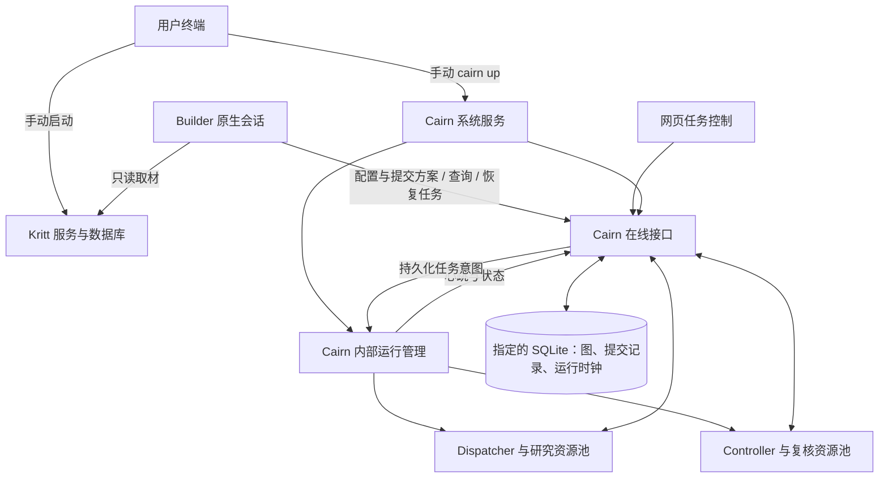

# 任务恢复与运行面板开发方案

日期：2026-10-12。版本：v0.2。状态：分段实施。方案起始基线：`8306eac`；REC-CP2 开发基线：`ba0833f`。

本文描述完整开发目标；已交付范围以本节开发状态和检查点材料为准。已确认的产品决定：**停机暂停预算，恢复后继续使用剩余额度；Kritt/Cairn 服务由用户手动启动，Builder 只使用已在线服务，可提交并开始研究任务**。

开发状态（2026-10-13）：REC-CP1 已验收并提交（`ba0833f`），REC-CP2 已复验通过并提交（`8182f91`）。REC-CP3 在 `codex/task-recovery-cp3` 实现在线控制与运行面板，已通过独立验收；使用方式见[在线服务指南](../managed-service.md)。REC-CP4 的 Skill 提交/恢复路由尚未开发。

## 1. 交付目标与范围

用户先手动启动 Kritt 和 Cairn 服务。Builder 连接已在线的服务，配置本次任务资源池、取材、提交方案并开始研究；用户或 Builder 可通过纯客户端 CLI/API 恢复原项目，保留已入图成果、审计阶段和剩余时间。

**服务启停和任务操作分开：** Builder 不启动、关闭、重启 Kritt/Cairn 服务，不执行 Docker 启停，不在连接失败时拉起备用实例。任务提交、暂停、恢复是使用已有 Cairn；其内部 Worker 进程由 Cairn 自己按资源池管理。

一期交付“图级断点恢复”：已完成任务不重跑；中断的 Explore 重新执行原 Intent，并创建新 session。模型调用内部尚未持久化的进展不保证保留。

| 本轮实现 | 本轮不实现 |
|---|---|
| 同一 run、数据库、project ID、工作目录的恢复 | 恢复 Python 调用栈、CLI 内部每一步工具执行 |
| 人工暂停、故障中断、按原阶段恢复 | 无人值守的无限自动重启 |
| 持久化运行时钟、剩余预算与运行世代 | 重置完整预算、自动补充 Token 或时间 |
| 已持久化复核、Closing 和完成申请的继续处理 | 盲目重放旧 Reason 输出或任意历史回执 |
| 人工启动的 Cairn 服务、纯客户端提交/恢复、在线运行面板 | Builder/网页启停系统服务、外置常驻管理平台、浏览器执行 shell |
| 资源池占用摘要、恢复记录、受限日志查看 | 网页模型/provider 管理和资源池编辑器 |

主路径为原生 Builder 创建的本地 audit run。普通 generic 项目及旧 `serve/dispatch` 使用方式保持兼容；generic 的暂停预算、任意外部数据库的自动接管不在一期范围。

## 2. 现状与必须修正的位置

| 现状 | 实现依据 | 对恢复的影响 |
|---|---|---|
| `start` 遇到已有项目就拒绝 | [native.py](../../cairn/src/cairn/controller/native.py) | 必须增加独立恢复入口，不能重新调用建图分支 |
| `run_research` 每次创建项目，异常尝试设为 stopped，退出时关闭 Server | [research.py](../../cairn/src/cairn/controller/research.py) | 拆开首次创建与已有项目运行；暂停、终态不能直接销毁查看页面 |
| 服务仅记录 PID，Agent 已有进程身份登记 | [local.py](../../cairn/src/cairn/controller/local.py)、[owned_process.py](../../cairn/src/cairn/dispatcher/runtime/owned_process.py) | supervisor 崩溃后可能遗留服务；恢复必须识别本 run 的进程 |
| 研究与复核期限是绝对 UTC | [audit_budget.py](../../cairn/src/cairn/server/audit_budget.py)、[audit_review.py](../../cairn/src/cairn/server/audit_review.py) | 停机仍消耗预算，不能只修改页面倒计时 |
| Reason checkpoint 只在内存，启动时按当前图初始化 | [loop.py](../../cairn/src/cairn/dispatcher/scheduler/loop.py) | 可能漏掉崩溃前尚未处理的 Fact/Hint/复核变化 |
| 研究回执在 CLI 结束后保存 | [tasks/audit.py](../../cairn/src/cairn/dispatcher/tasks/audit.py) | 一期不能承诺续接所有中断 session |
| 页面 Resume 只执行 `PUT /projects/:id/status` | [index.html](../../cairn/src/cairn/server/static/index.html) | 状态变 active 不等于执行进程恢复 |

数据库已经保存图、policy、源码基线、审核记录、租约、Closing 和完成申请。继续使用 SQLite 与现有独立验收协议，不引入新的图数据库或 Agent 框架。

## 3. 服务入口、任务入口与恢复契约

### 3.1 用户手动启动系统服务

下列人工服务入口已在 REC-CP1 实现：

```sh
# 由用户在终端执行；Kritt 的启动命令继续使用其自身项目约定。
uv run --project cairn cairn up \
  --config dispatch.builder.yaml --db-path /absolute/path/to/cairn.db
```

`up` 以前台方式启动并持有 Cairn 的 Server、Dispatcher 和 Controller 调度能力，打印固定服务地址；用户 Ctrl+C 正常关闭，故障后由用户再次运行命令。它是 Cairn 自身的启动入口，不新增外部管理平台。无需用户逐个启动项目 Worker。

服务可以在没有研究任务时空闲；项目暂停、结束、预审要求修订都不关闭服务。Kritt 是否定期审计和更新数据库仍由 Kritt 自己负责，Builder 只读使用其产物。

新服务配置使用可连接的固定监听地址，例如 `http://127.0.0.1:8000`。旧配置中的端口 `0` 表示旧启动器动态分配，不能直接当成 Builder 的在线服务地址；迁移时由用户确定实际地址。

服务重启先将非终态的遗留活动任务标记为 interrupted，冻结到已保存预算，不自动恢复所有研究。服务就绪和任务恢复是两个独立动作。

### 3.2 Builder 使用在线服务

REC-CP1/CP2 已提供纯客户端接口：

```sh
cairn submit --server http://127.0.0.1:8000 --run-dir /path/to/prepared-run
cairn resume --server http://127.0.0.1:8000 --project PROJECT_ID
```

两者只向已启动 Cairn 提交请求，不在客户端拉起 Server、Dispatcher、Controller 或后台 supervisor。服务离线、执行组件未就绪或地址不匹配时，返回具体阻塞，并给出由用户手动执行的启动说明；不提供自动拉起 fallback。

Builder 可执行纯本地的 `prepare`、查询已有 Kritt 视图、读取源码、写方案和配置；允许通过上述客户端提交并开始任务。任务执行、预审和种子复核由 Cairn 服务的程序逻辑调度，不能由 Builder 直接调用底层创建接口绕过独立审核。

`submit` 将 plan、固定材料引用、本次资源池和预算快照交给在线 Cairn。服务接收后返回稳定的 submission/run ID，处理状态包括 preparing、needs_revision、running 或 error；Builder 根据 needs_revision 修订原方案并重新提交同一 submission。请求重试不得产生第二个项目，服务不能在 HTTP 处理函数中同步等待长模型调用。

准备材料仍在本机文件系统；服务仅使用收到的本次快照，不因为任务启动时本地 YAML 已变化而替换其配置。模型/provider 继续由本机 CLI 管理。

### 3.3 恢复原任务

恢复默认使用服务保存的任务配置、数据视图和原工作目录，不重新选择 Kritt scan、不重建种子图、不重新询问已选资源池。

| 原状态 | 行为 |
|---|---|
| 服务在线、任务正在运行 | 返回现有网页及状态，不重复启动执行 |
| 服务在线、任务暂停或中断 | 由 Cairn 内部调度恢复原任务，返回 resuming/running |
| Cairn 服务离线或管理组件失效 | 告知用户手动启动/重启服务；Builder 与网页均不代为执行 |
| 已创建项目但尚未激活 | 服务补齐原项目工作目录和交接，再激活原项目 |
| 只有准备材料、未提交任务 | 返回 not_submitted；Builder 可向在线服务提交，不宣称恢复成功 |
| completed / budget_exhausted | 展示或导出结果，保持终态 |
| 原项目属于另一份数据库 | 返回 not_registered；用户选择服务应打开的数据库，不自动复制或合并 |
| 源码基线或必要材料不可用 | 返回具体阻塞，保留状态和剩余预算，不创建替代项目 |
| 旧运行缺少预算时钟 | 按第 7 节处理，不猜测停机余额 |

返回至少包含 service/run/project 身份、运行状态、审计阶段、剩余时间、网页地址、运行目录及阻塞原因。客户端等待稳定结果或返回可查询的操作 ID，不因服务长期存活而等待它退出。

**SQLite 是任务图与阶段的权威来源。** 新任务使用人工启动服务所指定的数据库；run 目录保存该任务的材料、日志及项目定位。历史 run 自带 `cairn.db` 时，用户可以手动让 Cairn 打开这份数据库；一期不合并多个历史数据库，也不因 project ID 相同就认定是同一任务。

## 4. 运行结构与职责

Cairn 的系统服务生命周期独立于单个研究任务。用户手动启动服务后，Cairn 内部的管理循环按请求调度项目执行；Builder 是客户端，不是服务进程管理者。



职责：

| 主体 | 负责 | 不负责 |
|---|---|---|
| 用户 | 手动启动、关闭、重启 Kritt/Cairn，选择服务配置和数据库 | 为每个研究任务手工管理 Worker |
| Builder | 需求交互、只读取材、资源池配置、生成与修订方案、提交/开始任务、使用恢复接口、查看结果 | Docker/服务启停、后台守护、故障后自动启动另一套 Cairn |
| Cairn 内部运行管理 | 心跳、任务接纳、独占执行、暂停/恢复、管理 Worker、保存运行历史 | 要求 Builder 执行进程管理命令 |
| Server | 时钟、状态事务、提交与恢复接口、前端数据 | 接受浏览器传入任意系统启动命令 |
| Dispatcher/Controller | 按本项目有效资源池执行和取消任务、独立审核与结案 | 改变系统服务由人管理的边界 |
| 前端 | 项目级开始/暂停/恢复、进度与故障展示 | 启停 Cairn/Kritt 服务 |

预审 needs_revision 只暂停该提交并把意见返回 Builder；空闲、暂停或任务结束都不退出整个服务。用户关闭服务时，Cairn 负责收敛所拥有的任务进程并保存可恢复状态。

资源池按项目提交为服务端快照。Builder 修改本地 YAML 后，必须把本次选定配置随提交传入；不能认为常驻服务已经自动读到文件修改。调度器按快照派生项目执行容量，保持“3 Claude + 2 Grok = 5 Explore”；现有固定线程容量也需相应调整，不能因服务启动时只有1个名额而压低后续项目池。服务的 `max_running_projects` 仍控制同时接纳的项目数。

## 5. 最小持久化模型与状态

### 5.1 运行状态与审计阶段分开

保留 `audit.phase` 的 preparing/researching/draining/finalizing/closed；另记录运行状态：

| 运行状态 | 含义 |
|---|---|
| starting / resuming | 已在线服务正在准备或恢复任务，不提前派发模型调用 |
| running | 当前世代可以按审计阶段执行任务 |
| pausing | 停止新派发，正在回收在途调用 |
| paused | 人工暂停，模型进程已收敛，预算冻结 |
| interrupted | 运行世代失效或必需服务故障，需显式恢复 |
| blocked | 恢复所需材料/进程身份/旧预算不满足，附具体原因 |
| finished | 业务终态；页面仍可查看，模型进程已退出 |

暂停或崩溃不把审计阶段倒退为 researching。`stopped` 不再被当作唯一的故障描述。旧模式的 status 接口保持兼容；受管理的 audit 通过运行控制流程暂停/恢复。

暂停确认或中断落库后，将 `project.status` 设为 stopped，保留 `audit.phase`，由运行状态区分人工暂停与故障。恢复事务按原阶段映射：researching → active；draining/finalizing → draining；preparing 保持 stopped，完成交接后通过原 `audit/start` 首次激活。completed/budget_exhausted 不变。新 Server 对未结束的旧活动记录先标记 interrupted，再开放运行控制接口。

受管理 audit 的旧 `PUT status` 路径不得绕过运行许可和时钟：active 请求交给恢复流程，stopped 请求交给暂停流程；原独立运行的 generic/legacy 语义不变。

### 5.2 保存一份小型运行记录

新增 `project_runtime` 表，按 project ID 保存紧凑运行记录。不要把每两秒更新的心跳写进包含全量源码指纹的 `audit metadata_json`，避免持续重写大块基线数据。

最小字段组：

- 身份：run ID、project ID、运行目录、当前 `generation`、owner ID。
- 控制：期望运行/暂停、实际状态、最近错误和停止原因。
- 时钟：累计有效运行毫秒数、时钟版本、当前 Server 实例 ID、实例内单调时钟锚点及续租窗口。
- 状态摘要：最后心跳时间、当前有效角色池及占用、最近恢复时间。
- 生命周期历史：仅记录启动、暂停、中断、恢复、结束及旧预算迁移；不为每个心跳新增历史事件。

生命周期事件可放在该小型记录的历史集合中；详细进程日志保存在运行目录。首次落库、状态转换、世代更新和预算结算使用现有 SQLite 事务。

run 目录的 `run.json`、`project.json`、`research.json` 继续作为任务入口或投影；系统服务的启动记录与任务目录分开。旧 run 的 `launch.json` 只作为历史定位线索，不让 Builder 据此接管服务，不维护第二套可独立改写的业务状态。

准备阶段另保存小型 `audit_submissions` 记录：稳定提交 ID、方案版本、材料与配置快照位置、准备状态、修订意见及唯一 project ID。模型工作由服务内任务处理器认领；收到同一提交的重试返回同一记录，needs_revision 修订限定在原提交中，创建项目后不可被旧修订覆盖。它只承载当前既有预审/建图流程，不扩展成通用队列框架。

## 6. 停机暂停的预算时钟

### 6.1 保留原有预算窗口，只替换计时依据

设累计有效运行时间为 `E`，原配置分别为研究 `r`、在途收尾 `d`、结案 `f`：

```text
研究窗口结束：R = r
在途收尾窗口结束：D = r + d
最终控制窗口结束：F = r + d + f
```

所有阶段推进改用 `E` 与这些累计阈值比较。原有“没有在途任务就提前进入 finalizing”的行为保留，不能悄悄改成每进入阶段就重新领取该阶段预算。准备阶段仍不计入项目运行预算。

暂停不增加 E，恢复从原 E 继续。60 分钟研究预算已经用了 20 分钟，停机一天后恢复，研究窗口仍剩 40 分钟。

### 6.2 单一时钟来源

Server 负责计算有效运行时间；浏览器和 Controller 消费 Server 返回的剩余秒数，不使用各自 `Date.now()` / `datetime.now()` 决定业务期限。

建议采用固定内部常量：Cairn 内部运行管理为执行中的项目每 2 秒心跳，10 秒续租窗口。它们不是新增用户预算参数。

1. 同一 Server 实例内使用单调时钟计算增量，避免系统校时导致预算倒退或跳变。
2. 只对 running、pausing 且 owner 续租有效的时间累计 E；paused/interrupted/finished 不累计。resuming 阶段先完成旧进程收敛，再开放执行与计时。
3. 结算最多推进到本次续租窗口末尾；长时间无人续租不能把全部停机时间算入预算。
4. 心跳和阶段/结果事务保存 E。Server 使用新的实例 ID 启动时，不比较或沿用旧实例的单调时钟锚点，冻结在最后持久化的 E，等待显式恢复。
5. Server 存活而内部运行管理失效时，窗口到期后标记 interrupted；旧 owner 迟到心跳不能自动重新开放执行。

硬崩溃无法精确记录崩溃瞬间。正常情况下误差接近持久化间隔；异常情况下按续租窗口说明误差上界，不声称毫秒级准确暂停。运行期间应有独立于长模型调用的心跳/失联处理：相关进程发现 owner 失效就停止派发并取消在途调用。Server 无法响应时，按最后确认的续租窗口退出执行，不能无限继续运行。

### 6.3 统一阶段与审核期限

必须抽出统一的项目预算视图，例如 `budget_view(project)`，由它提供当前 E、阶段剩余时长、最终控制窗口剩余时长，以及当前审核尝试剩余时长。

以下位置必须一并迁移，不能只平移三个项目 deadline：

| 消费方 | 必须统一的比较 |
|---|---|
| `server/audit_budget.py` | 新研究、在途写回、阶段推进、Closing 的轮次与单次期限 |
| `server/audit_review.py` | completion 的提交窗口、轮次期限、单次期限、过期裁决 |
| `server/services.py` | `has_pending_completion()` 等暂停研究的判断 |
| `server/routers/projects.py` | 是否允许恢复及恢复到哪个阶段 |
| `controller/monitor.py` | 各调用的剩余执行时间，移除本机 UTC 减法 |
| 前端 | 剩余预算与按钮可用性，移除绝对日期比较 |

新模式的轮次/单次业务期限使用有效运行时间上的偏移量。原 UTC deadline 字段仅供旧模式兼容；不能同时充当新模式的权威期限。真实事件时间仍使用 UTC 记录，API 将“事件发生时间”与“剩余运行秒数”分开。

CLI 单次 timeout、HTTP timeout、进程终止宽限、任务心跳租约继续使用真实经过时间；进程不能因项目暂停而无限挂起。暂停时取消在途调用，恢复时重新领取调用与任务租约。

## 7. 旧运行的兼容处理

`8306eac` 及此前运行没有可靠的有效运行计时，不能推断准确停机余额。

- 已完成或已 budget_exhausted：保持终态，只查看与导出。
- 尚未激活：首次激活时使用新时钟，不需要补偿运行预算。
- 已激活、未结束、无新时钟：第一次恢复返回 `needs_budget`，显示原阶段、原预算和最后已知状态，不自动补满或立即判为耗尽。
- 用户明确提供**当前阶段剩余秒数**后，执行一次性迁移；在线恢复客户端可用 `--remaining-seconds N`，Skill 用自然语言追问，在线页面使用一个输入框。该参数只服务旧运行迁移，新运行不需要。
- 剩余额度不能超过该阶段原来可能获得的窗口；迁移记录用户输入、原字段、采用的 E 和时间。后续恢复不能再次用此参数增加额度。

迁移换算：researching 的 `E = R - N`，draining 的 `E = D - N`，finalizing 的 `E = F - N`。分别限制 `0 ≤ N ≤ r`、`0 ≤ N ≤ d`、`0 ≤ N ≤ d + f`，且不倒退已保存阶段。N 为 0 时按阶段推进规则处理，不伪造完成结论。

这一步是补充旧版本未保存的信息，不是每次恢复增加审批流程。旧进程无法核验身份或无法确定已收敛时，保持 blocked，不按裸 PID/端口杀进程，也不另起一套模型执行。

## 8. 恢复与暂停的实现顺序

### 8.1 独占接管与遗留进程

人工启动 Cairn 时，对指定数据库/服务目录取得实例锁，防止两套系统服务管理同一份运行状态。项目恢复另做事务性独占；锁空闲不等于旧子进程已经退出。

- 将现有 Agent 的身份登记扩展到 Cairn 服务管理者、Server、Dispatcher、Controller，保留 run ID、角色、PID、PGID、启动身份与世代。
- 登记要覆盖创建进程到持久化父进程状态之间的崩溃窗口，优先复用 `owned_process.py` 的 exec 前登记。
- 用户手动启动/重启 Cairn 时，程序核验并收敛旧服务与旧世代的遗留进程；已在线服务中的任务恢复只处理该任务。Builder 不承担进程扫描、回收或系统接管。
- 不按端口占用或 `kill(pid, 0)` 单独判断归属。新版本无法确认归属时给出阻塞信息，不扩大回收范围。

### 8.2 世代与过期调用

每次真正恢复执行时，在 Server 事务内递增 generation。研究和复核客户端自动携带运行世代，Prompt 与用户无需填写。

服务端对受管理任务的领取、写回和审核提交检查世代及运行许可；旧世代的延迟输出不能在新世代继续落图。既有 lease/token/input_digest 检查继续生效。

任务暂停时先停止新派发，再取消在途调用和清理旧租约；待进程收敛后确认 paused 并冻结预算。若 Cairn 内部管理者在 pausing 时崩溃，由续租失效路径转为 interrupted。恢复不等待旧 Agent 无限完成。

数据库状态和世代变化完成后再开放执行；重复点击恢复、两个并发 resume、旧心跳重试都不得生成两套执行进程或多扣/多补预算。

### 8.3 恢复原项目

将 `run_research` 的“启动服务”“提交并创建项目”“执行已有项目”拆开：服务由人工 `up` 持有，纯客户端只提交请求，运行管理共用首次执行与恢复逻辑。恢复分支不能调用导入种子或创建项目。

- 同一数据库、project ID、源码基线、资料视图和工作目录保持不变。
- 工作目录未完成交接时，已有相同 repo 链接不报错；资料复制、input.json 和记录交接可重复执行，完成后只激活原项目。
- 已完成 Intent 以数据库 `to` 为准；提交成功但客户端未收到响应，不得再创建一条 Fact。
- 未完成 Intent 重新领取并使用新 session；不直接提交未知来源或半写入的旧输出。
- 已成功的复核按现有输入摘要复用。中断调用记录为执行中断，不作为证据驳回；旧 token 失效后进行有界重试。
- 恢复只给中断执行建立新的有界尝试，沿用 `review.max_attempts` 并保留历史；实质性的 rejected/needs_evidence 不因恢复重新提交相同依据。所有重试仍消耗同一份剩余运行预算。
- Closing 已保存成功结果但尚未提交候选时，继续原候选提交；已批准的完成申请不重复批准。

恢复 researching 时安排一次必要的 Reason，或持久化最后成功消费的 revision。第一版可选择“恢复后补一次 Reason”，但应等 completion_pending 等既有条件解除，不绕过审核暂停。不能再把恢复时的当前图无条件设为已处理 checkpoint。

Reason 旧输出可能已经逐项写入了一部分 Intent，一期不自动重放这些输出。新 Reason 从当前图继续分析，已落图动作保留。通用的动作幂等与精确回执重放后置。

### 8.4 结果、日志与人工关闭服务

任务日志按 generation 分目录保存，历史日志不覆盖。run 根目录状态文件指向当前一代；恢复历史包含来源状态、原因、剩余时间及被重新执行的 Intent 数量。

任务暂停：收敛该项目模型调用，预算冻结，系统服务继续运行。完成/预算耗尽：停止该项目调度并导出结果，系统服务继续运行。一次任务失败不关闭其他项目或网页。

仅用户的系统服务命令或终端中断负责关闭 Cairn。服务收到正常终止信号时，停止新接单、收敛任务、保存预算与状态，再关闭自身进程。Builder 和网页没有“关闭系统服务”动作；不新增让 Agent 执行的 shutdown 入口。

## 9. 最小接口与前后端协作

当前接口遵循现有路由惯例，所有控制请求都只使用已在线服务：

| 接口 | 语义 |
|---|---|
| `GET /runtime/health` | 服务实例、数据库身份及 Server/执行调度是否就绪；只读 |
| `POST /audit-submissions` | 接收 plan、材料引用与本次配置快照，返回稳定提交 ID，服务内部执行独立预审 |
| `GET /audit-submissions/:id` | 查询准备、修订意见、执行错误或已创建的项目 |
| `PUT /audit-submissions/:id` | 在 needs_revision 下修订同一提交，不重复创建项目 |
| `GET /projects/:id/runtime` | 实际任务状态、阶段、预算、池占用、错误与可用动作 |
| `POST /projects/:id/runtime/pause` | 幂等请求暂停任务，返回 pausing/paused |
| `POST /projects/:id/runtime/resume` | 在线服务恢复原任务，返回 resuming/running 或具体阻塞 |
| `runtime.heartbeat`（内部调用） | 服务内运行管理续租；不开放网页或 Agent 的心跳写入口 |
| `GET /projects/:id/runtime/logs` | 查看本项目允许的日志尾部，不接受任意文件路径 |

提交和控制意图持久化后，由 Cairn 的内部调度消费。HTTP 请求不等待长模型调用；重复请求使用同一提交/操作身份，不重复建图或启动执行。复用已有材料、审核回执和项目数据，不建设额外通用工作流平台。

Server 尚存但必需的管理/执行组件失效时，返回 `service_unavailable` 和人工重启说明，不返回无人消费的 resuming。Builder 只报告并等待用户恢复服务。Cairn 自身在一次健康服务实例内管理项目 Worker 的创建/退出，不属于 Builder 启动系统服务。

`runtime` 响应至少提供服务/数据库/run/project身份、generation、state、audit_phase、预算快照、last_heartbeat_at、last_error、项目资源池、slots_in_use、可用动作/阻塞原因和网页地址。

角色占用由 Dispatcher/Controller 的实际在途集合汇报，附更新时间；失联时为未知/上次值，不能伪装为0。不从 Worker 名猜容量，也不为展示建设另一套任务队列。

Cairn 只执行人工配置的本机运行方式；HTTP 不接受任意 shell 或系统服务启动命令。客户端必须核对服务及任务归属，不能把纯 `serve` 数据查看实例、端口0或另一数据库上的同名 project 当作已就绪执行服务。原 `cairn serve --db-path ...` 仍可用于查看历史数据，但仅启动 Server 不等于完整 Cairn 已具备提交和恢复执行能力。

## 10. 前端评估与本轮改动

### 10.1 现有页面的问题

当前页面已有任务图、布局切换、历史回放、Hint、日志、Stop/Resume、generic Reopen，以及审核信息卡。主要缺口是运行信息分散、生命周期操作含义不准确，不能通过多加几个图标解决。

- Resume 只改状态，无法恢复进程。
- Stop 会导致当前启动器把 Server 也关闭。
- audit 卡显示最终绝对期限，缺少暂停后的剩余额度。
- 只有 Reason/Intent 的局部 Worker 信息，没有角色池总体占用。
- 断网时主要显示短暂提示或控制台错误，旧图容易被误认为仍在更新。
- Replay 是历史动画；generic Reopen 是重新打开已完成问题，均不承担运行恢复。

### 10.2 建议按钮

| 按钮 | 优先级 | 显示与行为 |
|---|---|---|
| 暂停研究 | 本轮必做 | running 时主操作；暂停期间禁用重复点击，显示“正在收敛在途任务” |
| 恢复研究 | 本轮必做 | 服务已就绪，且 paused/interrupted 可恢复；由在线系统恢复任务执行 |
| 查看中断原因/运行日志 | 本轮必做 | 展示最后错误、影响阶段、具体恢复阻塞和本 run 日志 |
| 重试连接、复制人工启动说明 | 本轮必做 | 服务离线时；由用户回终端操作，网页不启动系统服务 |
| 查看资源池 | 本轮只读 | 展示角色、harness、配置容量、占用及更新时间 |
| 导出结果、历史回放 | 复用现有 | 清晰命名，终态优先展示结果动作 |
| 网页编辑资源池/模型 | 后置 | 本轮继续使用 Skill 配置，避免扩大恢复功能 |

批量 Stop 在受管理 audit 中改为批量暂停，只针对后端返回可暂停的项目，逐项显示成功或失败。generic 沿用原状态操作，不混同受管理恢复。

暂停按钮附近说明“未完成调用会取消，恢复后重新执行对应任务”，避免被理解为冻结 CLI 内部会话；不为每次暂停增加重复确认弹窗。

### 10.3 页面布局

保留现有 Alpine/Tailwind/Cytoscape 页面，在任务图上方增加紧凑运行概览，不更换前端框架。

```text
项目名称             [研究中 / 已暂停 / 运行中断]   [暂停或恢复] [更多]
开题准备 ─ 研究 ─ 在途收尾 ─ 独立结案              数据更新于 …

当前阶段剩余 40:00     Explore 3/5     Reason 1/1     复核 1/2
待执行方向 8          待复核节点 3     最新成果 …

┌──────────────────────────┬──────────────────────────────┐
│                          │ 运行概览 / 节点详情 / Hints   │
│        现有任务图        │ 资源池与占用                  │
│                          │ 中断原因与最近恢复记录        │
│                          │ 完成申请与结案结果            │
└──────────────────────────┴──────────────────────────────┘
```

- 状态色统一：运行中青色、暂停琥珀色、中断/阻塞红色、已结束中性色；同时保留文字和图标，不能只靠颜色。
- 阶段条只表达当前阶段；预算进度条明确标为“时间预算消耗”，不伪造“研究完成百分比”。
- 图保持视觉中心，选中节点才展开详细操作。将低频的删除、导出放进次级菜单；不提供系统服务电源按钮。
- 暂停时倒计时停止；resuming 显示“读取任务状态/恢复工作目录/恢复调度”等真实进度，不制造百分比。
- 移动窄屏将概览卡换行、详情抽屉化，保留一个明确主操作。
- 统一新运行操作的中文文案；保留图编辑功能，避免把这次改动扩大为全站翻译或主题重做。

### 10.4 系统服务离线

已打开页面保留最后成功快照，并持续显示“Cairn 服务离线，数据截至……”，停止预算动画和运行光效，禁用任务写操作。保留重试连接、服务地址和人工启动说明；Builder 也只给出说明，不执行它。

Server 已退出后整页刷新可能无法加载页面。用户在终端手动重新启动 Cairn，服务恢复后再通过网页、Builder 或纯客户端恢复任务。服务命令打印实际地址；端口被占用时不杀其他进程，也不由 Builder 自动选择端口启动备用服务。重连核对服务/数据库身份和 project 归属。

## 11. 原生 Skill：只使用服务

将 `/cairn-builder` 的服务职责写成明确约束：Kritt/Cairn 的启动、关闭、重启均由人手动执行；Builder 不调用 Docker 启停或 Cairn 系统启动器。服务不可用时，说明缺少什么并等待，不自动修复服务生命周期。

### 11.1 新任务

1. 读取用户提供或已配置的在线 Cairn 地址，确认它是就绪的执行服务；Kritt 不可用时报告读库阻塞，只有用户指定离线视图时才使用该视图。
2. 继续主动询问并配置资源池；本地保存选择，随本次提交一起传给服务端，不能假装服务已热加载。
3. 复用 prepare/只读查询/源码阅读，形成 AuditPlan；提交给已在线 Cairn，允许开始研究。
4. needs_revision 返回当前会话处理；方案通过后返回项目网页和进度，不代替独立审核。

### 11.2 恢复任务

1. 定位当前服务中的原项目，展示原阶段、原资源池和预算，不进入新建流程。
2. 新模式直接请求在线任务恢复；旧模式仅追问缺失余额。系统服务离线时停在人工启动说明。
3. 使用原材料和 Goal/policy，不刷新 Kritt、不新建替代任务；资源池变更只有用户明确要求时处理。

### 11.3 开发期间的真实能力边界

`8306eac` 的 `cairn start` 会启动整套后台服务，不能当作纯提交接口。新客户端完成前，Skill 可以配置资源池、准备材料和生成 plan，但不得自行执行旧 start，也不得绕过独立审核直接调用底层创建接口。

需要实际运行时，当前只能交付方案和由用户手动执行的旧兼容命令；若用户已经启动另一套 Cairn，明确缺少连接现有服务的提交链路，不再启动第二套。新客户端验收通过后，才将 Skill 切换为调用 submit/resume。Skill源码、分发包、README和指南同步，区分当前过渡行为与待开发能力。

## 12. 开发顺序与验收检查点

沿用分段交接：每个检查点完成后停止，由验收方检查通过再继续。检查点不进入产品交互，不新增用户审批流水线。

| 检查点 | 必须完成 | 可运行验收 |
|---|---|---|
| REC-CP1：人工服务与客户端分离 | 人工up入口、固定服务身份/地址、在线提交与独立预审、项目配置快照、服务与任务生命周期分离 | 人手动启动真实服务；纯客户端提交产生原图和一个结果；提交/暂停/结束均不启停系统服务；离线提交不创建任何服务进程 |
| REC-CP2：暂停时钟与任务恢复 | 小型运行时钟、统一预算视图、世代、纯客户端resume、旧预算迁移、进程收敛、Reason恢复触发 | 可控时钟验证20分钟运行+24小时停机后仍剩40分钟；人工重启服务后显式恢复同project；旧进程不能写回，双resume不重复派发 |
| REC-CP3：在线控制与运行面板 | 在线暂停/恢复按钮、概览/预算/池占用/故障/日志、离线退化 | 浏览器操作暂停后页面仍可用；恢复后名额重新派发；杀Server显示离线，人工重启后可重连并恢复任务；批量操作、连点及终态按钮符合实际状态 |
| REC-CP4：Skill、兼容与完整交付 | 恢复路由、旧运行余额交互、文档/打包、故障回归及交付说明 | 服务由人启动；从原生对话提交并恢复一次任务，验证Builder不启停服务；完整走完独立终审；确认终态/结果/历史一致；原439项基线及新增相关回归通过 |

REC-CP1 前移一次真实 harness 的小演示：仅使用合成源码/固定文本任务，在人工启动的服务中提交合成任务并产生一个 Fact；REC-CP2 再加入人工重启服务、显式恢复后产生后续结果。只需验证进程、契约和原图延续，不使用真实漏洞目标；真模型证据与假 CLI 并发/强杀证据分别标注。

## 13. 必须覆盖的故障场景

| 场景 | 通过标准 |
|---|---|
| Explorer/Dispatcher 退出，已有成果入图 | 原Fact与Intent关系保留，中断Intent可重新执行，session重新创建 |
| 系统管理进程被强杀但子服务存活 | 续租到期后停止接纳旧世代；用户手动重启时程序核验并收敛遗留进程，Builder不介入进程管理 |
| Server 被强杀/主机重启 | 等用户手动启动；预算从持久化E恢复，任务保持interrupted直至显式resume；旧时钟锚点不复用 |
| API写入成功但响应丢失 | 根据DB确认完成，不重复Fact；不盲目重放Reason动作 |
| Fact已新增，Reason尚未处理时崩溃 | 恢复后能触发必要Reason，不吞掉revision变化 |
| draining/finalizing时中断 | 回到原阶段；禁止新增Explore；仍可完成复核与结案 |
| completion/Closing正在执行时暂停 | 旧token/世代不能提交；已成功结果保留；中断执行按有限规则重试 |
| 原项目已completed或budget_exhausted | 恢复只查看与导出，不重置预算或重新研究 |
| 旧运行首次迁移预算 | 只询问缺失余额，记录一次性迁移；再次恢复不重复授予时间，终态不允许借迁移重开 |
| 配置/源码卷缺失或身份无法核验 | 明确blocked，余额冻结，不创建新项目或误杀其他进程 |
| 服务离线时Builder提交/恢复 | 仅报告人工启动说明，不启动备用服务、Docker或更换端口 |
| 恢复按钮连点/客户端与页面同时恢复 | 同一任务恢复操作、同一世代，不重复派发 |

不要求为文案和样式写实现镜像测试。后端重点测试时钟、事务、所有权和故障窗口；前端至少做一次真实浏览器交互验证，截图只辅助，不替代状态/进程断言。

## 14. 文件改动范围与后置项

| 区域 | 主要改动 |
|---|---|
| `cli.py`、`controller/native.py`、`research.py`、`local.py` | 人工up与纯客户端submit/resume分离，服务管理与项目执行解耦，追加日志 |
| `runtime/owned_process.py`、进程取消/心跳辅助 | 服务身份登记、世代失效时有界退出 |
| Server models/db/routers、统一运行时钟模块 | 小型运行记录、提交记录、项目配置快照、在线任务控制、统一时钟 |
| `audit_budget.py`、`audit_review.py`、`services.py` | 全部项目/轮次/单次业务期限使用同一预算视图 |
| Dispatcher、Controller、角色池执行辅助 | 恢复派发、Reason触发、世代携带、占用摘要 |
| `server/static/index.html` | 实际生命周期按钮、运行概览、故障与离线提示 |
| `.claude/skills/cairn-builder/`、使用指南、示例 | 禁止服务启停、在线提交/恢复、旧余额说明、重新打包 |

后置：CLI会话内部续接、结果自动重放、Reason动作幂等批提交、多数据库合并控制台、网页资源池编辑、自动守护重启。新增这些能力时再引入相应状态，不提前建设通用任务平台。

本方案完成后应保证：用户知道任务是否真的在运行、还剩多少时间、为何中断，以及下一步能执行什么操作；已有成果与独立结案语义保持不变。
